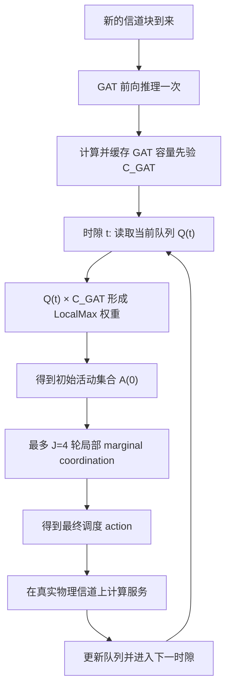

# Chapter V GAT-MP 代码导读与后续验证计划

这份文档只解释第五章调度代码。第四章 GAT 的网络结构、训练代码、
checkpoint 和训练数据不在本次修改范围内。

2026-08-11 的实际执行结果、正式 Fig. 5 数值和 Fig. 7 资源门控见
`docs/CHAPTER5_EXECUTION_REPORT_ZH.md`。

如果现在精力有限，建议只读：

1. “toggle 是什么”；
2. “新算法的一轮在做什么”；
3. “为什么短测试可能变好”；
4. 最后的“下一步执行顺序”。

---

## 1. toggle 是什么

`toggle` 的直译是“翻转状态”。这里每条链路只有两个状态：

- `0`：本时隙不激活；
- `1`：本时隙激活。

因此一次 toggle 有两种含义：

- `0 -> 1`：链路申请加入活动集合；
- `1 -> 0`：链路申请退出活动集合。

代码使用 XOR（异或）一次完成这两种变化：

```text
当前 action:     [1, 0, 1, 0]
确认的 toggles: [0, 1, 1, 0]
XOR 后 action:  [1, 1, 0, 0]
```

上面的链路 1 从 `0` 变成 `1`，属于加入；链路 2 从 `1` 变成 `0`，
属于退出。没有被确认的链路保持不变。

对应代码是：

```python
action = torch.logical_xor(action, confirmed)
```

这里的 `accepted_toggles_per_round` 就是“这一轮最终获准改变状态的链路数”。

---

## 2. 两个时间尺度分别做什么



### 信道块尺度

GAT 只负责提供信道先验。`QueueChannelLocalMaxScheduler._expected_rate()`
现在缓存最终容量先验，而不只是缓存 logits。同一个 `state` 的后续时隙
直接使用缓存，因此不会重复执行 GAT。

### 时隙尺度

队列 `Q(t)` 每个时隙都可能变化，所以 LocalMax 和四轮 MP 仍然每个时隙执行。
这不是重复执行 GAT，而是利用同一个信道先验处理新的队列状态。

---

## 3. 新算法的一轮在做什么

核心文件：[`models/marginal_mp.py`](../models/marginal_mp.py)。

建议按下面顺序对照代码，不需要从文件第一行一直读到最后：

| 阅读顺序 | 函数或文件 | 先看什么 |
|---:|---|---|
| 1 | [`build_conflict_neighbors()`](../models/marginal_mp.py) | incoming/outgoing 邻居怎么得到 |
| 2 | [`conflict_graph_toggle_marginals()`](../models/marginal_mp.py) | 加入和退出的局部收益怎么组成 |
| 3 | [`confirm_disjoint_neighborhood_proposals()`](../models/marginal_mp.py) | 为什么共享第三个邻居的候选不能同时通过 |
| 4 | [`confirm_endpoint_join_proposals()`](../models/marginal_mp.py) | 两个 UAV 端点怎样确认加入 |
| 5 | [`MarginalMPScheduler.schedule_with_state()`](../models/marginal_mp.py) | 一轮怎样串起 proposal、确认和 XOR |
| 6 | [`QueueChannelLocalMaxScheduler`](../models/local_physical_reuse.py) | GAT 容量先验怎样缓存 |
| 7 | [`run_mobile_queue_simulation()`](../simulator/mobile_block_fading.py) | observed CSI 排程和 true CSI 服务怎样分开 |
| 8 | [`tests/test_marginal_mp.py`](../tests/test_marginal_mp.py) | 用最小网络看每条规则的例子 |

### 第一步：建立局部邻居

函数：`build_conflict_neighbors()` 和 `build_coordination_neighborhoods()`。

对链路 `i`，代码分别保存：

- incoming neighbors：哪些活动链路会干扰 `i` 的接收机；
- outgoing neighbors：`i` 激活后会干扰哪些接收机；
- closed neighborhood `S_i`：`i` 自己加上 incoming/outgoing neighbors。

`S_i` 不是整张网络，而是候选 `i` 这次状态变化会影响的协调范围。

### 第二步：只计算 conflict-edge 干扰

函数：`compute_graph_local_rates()`。

它调用 `local_edge_gains(state)`，只提取：

- 每条链路的直达功率；
- conflict graph 边上对应的交叉干扰功率。

如果完整功率矩阵中存在一项弱干扰，但它没有对应 conflict edge，
该功率不会进入局部速率和 marginal。

### 第三步：计算每条链路的 toggle marginal

函数：`conflict_graph_toggle_marginals()`。

`marginal` 可以理解为：

> 如果只翻转候选链路 i，局部冲突图效用预计改变多少？

对于非活动链路：

```text
加入 marginal
= 自己新增的 queue-weighted service
  + 活动 outgoing neighbors 的 queue-weighted rate variation
```

对于活动链路：

```text
退出 marginal
= 失去自己的 queue-weighted service
  + outgoing neighbors 因干扰消失得到的服务恢复
```

只有 `marginal > 0` 的链路形成 proposal。

### 第四步：协调邻域确认

函数：`confirm_disjoint_neighborhood_proposals()`。

每个协调成员只投票给自己看到的最大 marginal proposal；候选 `i` 必须得到
`S_i` 内所有成员的选择才通过。

这样可以避免下面这种旧方法处理不了的情况：

```text
候选 i —— 中间链路 k —— 候选 j
```

`i` 和 `j` 没有直接冲突边，但 `S_i` 和 `S_j` 都包含 `k`。由于 `k` 一轮只能
确认一个 proposal，`i` 和 `j` 不会同时被接受。

结果是同轮 accepted candidates 满足：

```text
S_i ∩ S_j = empty
```

这正是局部效用变化可以相加的条件。

### 第五步：UAV endpoint 确认

函数：`confirm_endpoint_join_proposals()`。

它只对 joining proposals 增加以下要求：

1. 两个端点 UAV 当前都没有被活动链路占用；
2. 如果多个 joining proposals 竞争同一个空闲 UAV，该 UAV 只选择
   marginal 最大的一个；
3. 一个 joining proposal 必须同时得到发送端和接收端确认。

退出提案不会占用新的端点，因此不需要这一步。

### 第六步：同时执行加入和退出

函数：`MarginalMPScheduler.schedule_with_state()`。

最终接受集合是：

```text
confirmed = neighborhood_ok AND endpoint_ok
```

然后通过 XOR 同时执行加入和退出。更新完成后只运行
`shared_uav_action_audit()` 检查结果，不再调用集中式 projection 修改本轮结果。

注意：`QueueSimulator` 为所有算法保留了统一的最终 feasibility projection。
对于 GAT-MP/Direct-MP，它应该是一个 no-op；移动 CSI smoke test中拒绝数确实为 0。
它不是 GAT-MP 每轮的一部分。

---

## 4. 与旧代码相比改变了什么

| 问题 | 旧实现 | 新实现 | 直接效果 |
|---|---|---|---|
| marginal 信息范围 | 候选到所有活动接收机 | 只使用 conflict-edge receivers | 不再依赖全网功率外部性 |
| 同轮 proposal 竞争 | 只阻止直接相邻候选 | 整个 `S_i` 一致确认 | accepted neighborhoods 不重叠 |
| 共享 UAV | XOR 后集中投影修复 | 加入前两个 endpoint 确认 | 接受集合就是实际执行集合 |
| 状态变化 | 加入和退出混在全局精确量中 | 显式 graph-local join/leave marginal | 更容易对应论文公式和排查 |
| GAT 缓存 | 缓存 logits，容量仍重复计算 | 缓存容量先验 | 同一 block GAT/容量计算一次 |
| 实验缓存 | 不区分 MP 协议 | 保存 protocol/model version | 不会误复用旧 MP task cache |

没有改变的内容：

- GAT 结构和参数；
- GAT checkpoint；
- 第四章训练和评测算法；
- 真实物理服务速率的计算；
- Direct-MP 消融方法；
- imperfect-CSI 下 observed state 排程、true state 服务结算的边界。

---

## 5. 为什么 50-slot 短测试中性能有所提高

目前只能给出“有代码证据支持的解释”，不能把它写成正式性能结论。

### 最直接的证据：活动链路变多

| 方法 | 修改前平均活动链路 | 修改后平均活动链路 |
|---|---:|---:|
| Direct-MP | 1.80 | 2.18 |
| GAT-MP | 1.84 | 2.20 |

同时 LocalMax 两个 baseline 完全不变，说明相同信道和 arrival trace 下，
变化来自 MP，而不是 GAT、数据或随机数发生变化。

### 最可能的机制

旧的 global-externality marginal 会把非冲突边上的弱物理干扰也计入候选代价。
这些弱干扰单项可能很小，但对许多活动接收机累加后，会让加入 proposal 更容易
得到负 marginal，从而减少空间复用。

新算法只计算论文定义的 conflict-graph utility。因此，只要某条链路在自己的
冲突邻域内带来的新增服务为正，并通过邻域和 endpoint 确认，它就可以加入。
短测试中活动链路从约 1.8 增加到约 2.2，与 goodput 增加、backlog 下降的方向一致。

另一个可能原因是旧代码先同时翻转，再用集中式 projection 删除共享端点冲突。
被 projection 删除的链路不一定等于分布式确认阶段本来应该接受的链路，且会浪费
这一轮的 proposal。新代码在更新前完成 endpoint arbitration，减少了这种不一致。

### 为什么现在不能下定论

当前比较只有：

- N=20；
- 一个 seed；
- 50 slots；
- 一个 arrival rate。

初始几十个时隙受空队列和启动过程影响很大。现在只能说“行为正常，并观察到与
更高空间复用一致的改善”，不能说新算法已经在统计上优于旧算法或所有 baseline。

---

## 6. 已通过的测试

运行命令：

```bash
MPLCONFIGDIR=/private/tmp/gnn_mpl_cache \
.venv/bin/python -m unittest discover -s tests
```

当前结果：63/63 tests passed。

测试内容包括：

- 修改非冲突功率不改变 marginal；
- local marginal 等于单链路翻转的 graph-local utility 变化；
- 加入和退出都能通过 XOR 执行；
- 重叠协调邻域不能同时被接受；
- 不重叠候选的联合变化等于 marginal 之和；
- endpoint 被占用时拒绝加入；
- 多个加入提案竞争 UAV 时至多接受一个；
- 每轮 conflict-graph utility 不下降；
- 调度使用 observed CSI，而不读取隐藏 true CSI；
- 同一 block 多个时隙只执行一次 GAT，但队列变化仍改变 LocalMax；
- 新 block 到来后重新执行 GAT。

---

## 7. 下一步测试计划

所有输出都放进新目录。以下命令不会重新训练 GAT。

### 分阶段运行原则

正式负载点不一次全部提交，而是分两批：

```text
代表点：0.5, 2.4, 3.5, 5.0
剩余点：1.0, 1.5, 2.0, 2.2, 2.6, 2.8, 3.0, 3.2, 4.0, 4.5
```

四个代表点分别覆盖低负载、论文常用工作点、中高负载过渡和最高负载。
代表点全部分析通过后，才利用同一输出目录中的版本化 task cache 补齐剩余点。

任一阶段出现以下情况就停止，不继续自动扩大实验：

- 进程崩溃、NaN、Inf、结果文件不完整；
- checkpoint 或数据 fingerprint 不匹配；
- `minimum_mp_local_utility_delta < -1e-4`；
- accepted neighborhoods 不互斥；
- GAT-MP/Direct-MP 出现 endpoint infeasibility；
- MP 的统一最终 projection 出现非零 rejection；
- 非零业务下长期为零服务或活动链路明显退化为全零/全开；
- 多个 seed 上 MP 同时出现 goodput 大幅下降和 backlog 数倍增加，且诊断无法解释。

单个点略低于 baseline、量化 CSI 不严格单调，或者短时间队列有波动，不能单独视为异常。

### T1：再次运行全套单元测试

目的：每次继续修改后先确认核心协议没有被破坏。

命令：

```bash
MPLCONFIGDIR=/private/tmp/gnn_mpl_cache \
UV_CACHE_DIR=/private/tmp/gnn_scheduling_uv_cache \
uv run python -m unittest discover -s tests
```

通过标准：

- 所有测试通过；
- 不允许删除 graph-local、endpoint、CSI 或 cache 测试来换取通过。

### T2：固定 CSI 小规模功能测试

目的：确认四种相关方法能在相同 trace 上运行，且 MP 没有退化成零活动或全活动。

```bash
MPLCONFIGDIR=/private/tmp/gnn_mpl_cache \
UV_CACHE_DIR=/private/tmp/gnn_scheduling_uv_cache \
uv run python -u experiments/exp_fixed_csi_qos.py \
  --num_uav 20 \
  --num_slots 200 \
  --arrival_rates 2.4 \
  --mc_seeds 42 \
  --rounds 4 \
  --channel_model_num_uav 20 \
  --channel_model rician \
  --rician_k_db 5 \
  --methods 'Direct-Link MarginalMP,GAT-Assisted MarginalMP,Direct-Link LocalMax,GAT-Assisted LocalMax' \
  --skip_mws \
  --delay_deadline_ms 2000 \
  --device cpu \
  --output_dir results/validation/ch5_local_coordination_v1/smoke_fixed_N20_seed42
```

通过标准：

- 进程正常结束；
- 四种方法都有有限的 backlog、goodput、delay 和 active-links；
- 两个 LocalMax 结果应与同 trace 的修改前结果一致；
- MP 的活动链路数应处于合理范围，但不规定必须高于某个 baseline。

### T3：中等规模多 seed A/B

目的：判断 50-slot 的提升是否只是随机或启动效应。

```bash
MPLCONFIGDIR=/private/tmp/gnn_mpl_cache \
UV_CACHE_DIR=/private/tmp/gnn_scheduling_uv_cache \
uv run python -u experiments/exp_fixed_csi_qos.py \
  --num_uav 20 \
  --num_slots 1000 \
  --arrival_rates 0.5,2.4,5.0 \
  --mc_seeds 42,43,44 \
  --rounds 4 \
  --channel_model_num_uav 20 \
  --channel_model rician \
  --rician_k_db 5 \
  --methods 'Direct-Link MarginalMP,GAT-Assisted MarginalMP,Direct-Link LocalMax,GAT-Assisted LocalMax' \
  --skip_mws \
  --delay_deadline_ms 2000 \
  --device cpu \
  --output_dir results/validation/ch5_local_coordination_v1/medium_fixed_N20_3seeds
```

重点比较：

- goodput、backlog、resolved delay；
- 平均活动链路数；
- seed 间方差；
- GAT-MP vs GAT-LocalMax；
- Direct-MP vs Direct-Link LocalMax；
- GAT-MP vs Direct-MP。

通过标准不是“GAT-MP 每个点必须第一”，而是：

- 结果没有异常爆炸、NaN 或持续零服务；
- MP 的改进方向在多个 seed 中不是完全由一个异常 seed 驱动；
- 若性能下降，能从 accepted toggles、活动链路或局部效用诊断解释。

### T4：移动 imperfect-CSI 小规模测试

目的：同时检查 observed CSI 排程、true CSI 服务结算、block cache 和 endpoint 可行性。

```bash
MPLCONFIGDIR=/private/tmp/gnn_mpl_cache \
UV_CACHE_DIR=/private/tmp/gnn_scheduling_uv_cache \
uv run python -u experiments/evaluate_mobile_block_fading_csi.py \
  --num-uav 20 \
  --num-slots 200 \
  --arrival-rates 2.4 \
  --seeds 42 \
  --speeds-mps 0 \
  --slots-per-block 5 \
  --stale-blocks 1 \
  --csi-methods latest,large_scale,quantized_4bit \
  --scheduler-variants gat_assisted,direct_link \
  --rounds 4 \
  --device cpu \
  --output results/validation/ch5_local_coordination_v1/mobile_csi_N20_seed42.json
```

通过标准：

- `marginal_protocol_version` 为 `conflict_graph_local_coordination_v1`；
- `shared_uav_feasible_all_slots` 为 true；
- GAT-MP/Direct-MP 的 `average_hard_projection_rejections` 为 0；
- 三种 observed CSI 得到的调度/性能可以不同；
- 服务指标仍由 realized true channel 结算。

### T5a：正式长度 Fig. 5 代表负载闸门

目的：更新第五章固定 CSI 正式结果。

正式运行前先完成下面修改计划中的 M1 和 M2。目前不要直接运行
`paper_figures/fig05_dynamic_queue/run.py`，因为它默认写入旧论文结果目录。

先只重跑两个发生变化的方法和四个代表负载，并输出到新目录：

```bash
MPLCONFIGDIR=/private/tmp/gnn_mpl_cache \
UV_CACHE_DIR=/private/tmp/gnn_scheduling_uv_cache \
uv run python -u experiments/exp_fixed_csi_qos.py \
  --num_uav 50 \
  --num_slots 10000 \
  --arrival_rates 0.5,2.4,3.5,5.0 \
  --mc_seeds 42 \
  --rounds 4 \
  --channel_model_num_uav 50 \
  --channel_model rician \
  --rician_k_db 5 \
  --methods 'Direct-Link MarginalMP,GAT-Assisted MarginalMP' \
  --skip_mws \
  --delay_deadline_ms 2000 \
  --device auto \
  --output_dir results/paper/ch5_local_coordination_v1/fig05_N50_seed42
```

通过标准：

- 四个代表 lambda 完成且使用新 fingerprint；
- 与旧 baseline 合并前，trace/topology fingerprint 必须一致；
- 重新核对 lambda=5.0 的 backlog、goodput 和消融比较；
- 不以“必须优于旧 global marginal”为通过条件。

### T5b：补齐 Fig. 5 剩余负载

T5a 无异常后，用同一个输出目录运行完整负载表。四个代表点会从新协议 task cache
读取，只计算剩余十个点：

```bash
MPLCONFIGDIR=/private/tmp/gnn_mpl_cache \
UV_CACHE_DIR=/private/tmp/gnn_scheduling_uv_cache \
uv run python -u experiments/exp_fixed_csi_qos.py \
  --num_uav 50 \
  --num_slots 10000 \
  --arrival_rates 0.5,1.0,1.5,2.0,2.2,2.4,2.6,2.8,3.0,3.2,3.5,4.0,4.5,5.0 \
  --mc_seeds 42 \
  --rounds 4 \
  --channel_model_num_uav 50 \
  --channel_model rician \
  --rician_k_db 5 \
  --methods 'Direct-Link MarginalMP,GAT-Assisted MarginalMP' \
  --skip_mws \
  --delay_deadline_ms 2000 \
  --device auto \
  --output_dir results/paper/ch5_local_coordination_v1/fig05_N50_seed42
```

### T6a：正式 Fig. 7 代表规模/CSI 闸门

先在 N=20 上运行 `latest,large_scale,quantized_4bit`，确认控制/服务 CSI 边界；
再用 N=50、2000 slots 检查大规模复杂度和可行性。两步均通过后才执行 T6b。

N=20 命令：

```bash
MPLCONFIGDIR=/private/tmp/gnn_mpl_cache \
UV_CACHE_DIR=/private/tmp/gnn_scheduling_uv_cache \
uv run python -u experiments/evaluate_mobile_block_fading_csi.py \
  --num-uav 20 \
  --num-slots 10000 \
  --arrival-rates 2.4 \
  --seeds 42 \
  --speeds-mps 0 \
  --slots-per-block 1 \
  --stale-blocks 1 \
  --csi-methods latest,large_scale,quantized_4bit \
  --scheduler-variants gat_assisted \
  --rounds 4 \
  --device auto \
  --output results/paper/ch5_local_coordination_v1/fig07_gate_N20.json
```

N=50 大规模闸门使用相同命令，但改为：

```text
--num-uav 50
--num-slots 2000
--csi-methods latest,quantized_4bit
--output results/paper/ch5_local_coordination_v1/fig07_gate_N50.json
```

### T6b：补齐 Fig. 7 Chapter V 全部条件

目的：更新 N=20/30/40/50 全部 imperfect-CSI 条件。

T6a 无异常后，以下面 N=20 为模板，分别将 `20` 和输出文件名替换成
30、40、50：

```bash
MPLCONFIGDIR=/private/tmp/gnn_mpl_cache \
UV_CACHE_DIR=/private/tmp/gnn_scheduling_uv_cache \
uv run python -u experiments/evaluate_mobile_block_fading_csi.py \
  --num-uav 20 \
  --num-slots 10000 \
  --arrival-rates 2.4 \
  --seeds 42 \
  --speeds-mps 0 \
  --slots-per-block 1 \
  --stale-blocks 1 \
  --csi-methods latest,large_scale,quantized_2bit,quantized_4bit,quantized_6bit,quantized_8bit,quantized_10bit \
  --scheduler-variants gat_assisted \
  --rounds 4 \
  --device auto \
  --output results/paper/ch5_local_coordination_v1/fig07_ch5_N20.json
```

通过标准：

- 4 个规模、7 个 CSI 条件全部完成；
- 不复用缺少 protocol version 的 progress；
- 全部时隙满足 endpoint feasibility；
- final projection rejection 为 0；
- 检查趋势是否仍支持论文结论，但不预设量化 CSI 必须严格单调。

---

## 8. 下一步修改计划

### M1：记录每时隙/每轮 MP 诊断

修改内容：

- 在固定 CSI benchmark 中收集 scheduler 的 `last_diagnostics`；
- 汇总 accepted toggles、positive proposals、局部效用增量、消息数和活动链路数；
- 只记录紧凑统计，不把每个时隙的大张量写入 JSON。

涉及文件：

- `simulator/queue_simulator.py`；
- `utils/fixed_csi_benchmark.py`；
- 对应单元测试。

目的：如果正式性能变化，可以直接回答“是 proposal 少了、endpoint 被拒绝、
邻域竞争增加，还是空间复用变化”，而不是只看最终 goodput 猜原因。

完成标准：

- 非 MP baseline 不受影响；
- 诊断字段长度和时隙/轮数一致；
- 每轮局部效用最小增量不为负；
- accepted neighborhoods 能从记录中复查。

### M2：为 Fig. 5/Fig. 7 wrapper 增加独立输出根目录

修改内容：

- Fig. 5 `run.py` 增加 `--output-root`；
- Fig. 5 `plot.py` 增加 `--raw-root`；
- Fig. 7 `resume.py` 增加 `--output-root` 或协议版本文件名；
- 默认不覆盖旧论文结果。

目的：让旧协议和新协议结果可以并排比较，避免误覆盖和误 resume。

完成标准：

- 指定新目录时所有文件只写入新目录；
- 旧目录哈希保持不变；
- 新目录缺少记录时可继续 resume；
- 协议版本不一致时不能跳过。

### M3：增加自动 A/B 汇总脚本

修改内容：

- 读取 old/new `metrics.json`；
- 输出 goodput、backlog、delay、active-links 的差值和相对变化；
- 同时显示 seed 数和 CI，禁止只比较单 seed 均值。

目的：减少人工复制数字造成的错误。

完成标准：同一文件重复运行结果一致，且缺失 method/lambda 时明确报告。

### M4：统一第五章对外名称

在正式数值稳定之后，把绘图显示名称统一为：

- Edge-Enhanced GAT；
- GAT-MP；
- Direct-MP；
- GAT-LocalMax；
- Direct-Link LocalMax。

内部 JSON key 可以保留旧名称以兼容已有结果。这一步不需要重新训练或重跑。

### 暂不进行的修改

- 不改 GAT 网络结构和 attention heads；
- 不改 node/edge preprocessing；
- 不改 link catalog；
- 不重新训练 GAT；
- 不修改第四章 N=20/N=30 数据指纹问题；
- 不修改论文正文。

这些问题需要单独立项，因为其中一些会使全部 checkpoint 和第四章结果失效。

---

## 9. 执行顺序与当前进度

```text
M1 诊断记录
  -> 全套单元测试
  -> T2 固定 CSI 200-slot smoke
  -> T3 1000-slot / 3-seed A/B
  -> 根据诊断判断是否还要改算法
  -> M2 独立结果目录
  -> M3 A/B 汇总
  -> T5 正式 Fig. 5
  -> T6 正式 Fig. 7 Chapter V
  -> 核对论文数字
  -> 最后做 M4 名称同步
```

如果 T3 已经显示明显异常，应停在 T3 排查，不应直接进入正式长仿真。

当前进度：M1--M3、T2--T5 和 T6a 已完成；T6b 因 N=50 实测运行成本达到
十余小时级而停在资源闸门，等待按 N 分批或转到服务器运行。详见执行报告。
