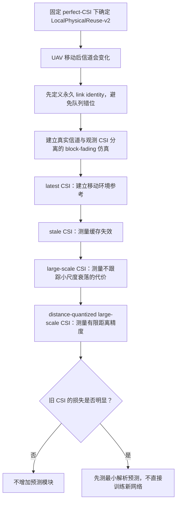

# 移动、不完美 CSI 与时空 GAT：统一研究教程与决策记录

> **架构状态更新（2026-07-18）**：本文后半部分仍按当时的
> LocalPhysicalReuse-v2/Join后端记录实验，不能作为当前调度架构定义。当前固定CSI
> 后端已经冻结为`Quality → LocalMax → K轮MarginalMP`（$K=4$，无Join）。未来CSI
> 工作应把预测/不确定性模块接入该后端，而不是继续修改本文的旧Join流程。

> **历史专项记录：** 从 2026-07-16 起，当时的移动信道、不完美 CSI、时间建模和
> CSI 鲁棒性实验曾统一记录在本文。后续若继续CSI任务，应先读取当前MarginalMP入口。
> 先前拆分的文档保留为原始实验快照，便于追溯数值，但不再承担“当前计划”作用。
>
> **最重要的物理修正：** 会议论文及此前数据使用的纯 Rayleigh 小尺度衰落，
> 不符合本文希望研究的 LoS 主导空对空 UAV 网络。它不是代码漏写，而是原始系统
> 模型选择错误。旧结果今后只作为算法结构诊断，不能继续充当期刊最终信道证据。
>
> **本文不是当前实现计划。** 它回答：旧模型究竟缺什么、STGNN 是否
> 有理论上可做的事情、GAT 应向两阶段调度输出什么、哪些路线值得在十天期限内投入。
> 大方向确认后，再把详细实验按“动机—定义—实现—结果—分析—下一步”继续追加
> 在本文。

---

## 0. 2026-07-16 最高优先级纠错：先恢复会议 GAT，再谈 CSI 鲁棒性

### 0.1 为什么必须暂停原来的 CSI/STGNN 实验

会议论文中的 GAT 输出不是后来新设计的“prior”。准确地说，网络先输出链路 $i$
的**软调度概率**

$$
\widetilde\pi_i=\operatorname{sigmoid}(c_i),
$$

再按会议算法得到真正执行的二元动作

$$
\pi_i=\mathbb 1[\widetilde\pi_i\geq0.5].
$$

$\widetilde\pi_i$ 接近 1 表示 GAT 强烈倾向于激活该链路；如果所有链路都接近 1，
阈值化后就是“所有链路同时发送”。这正是会议研究中需要避免的 full-transmission
collision collapse，不是正常的保守输出。

此前移动实验加载的两个后期 N=10 checkpoint 恰好发生了这种坍缩，却被错误地当成
正常 Frozen-GAT 继续使用。因此，在修复基线以前，继续分析 stale CSI、GRU 或常数
输出都没有意义：它们研究的是一个已经失去会议调度能力的模型。

### 0.2 实验 C0：会议 checkpoint 完整性审计

**动机。** 判断问题究竟来自会议 GAT 本身、当前推理代码，还是后期新训练的
checkpoint。

**定义与方法。** 以论文作图实际使用的四个实验为黄金参照：

- `exp_20_20260130_2147`；
- `exp_30_20260130_2236`；
- `exp_40_20260131_0118`；
- `exp_50_20260131_1740`。

对每个 checkpoint 在其原始测试集上重新计算：软 $\widetilde\pi$ 分布、阈值 0.5
后的硬激活比例、全发拓扑比例、硬调度 Shannon 容量以及全发容量。随后用完全相同
的审计检查后期 N=10 Rayleigh/Rician checkpoint。

**与此前做法的区别。** 此处不运行队列、不运行 LocalPhysicalReuse，也不把
$\widetilde\pi$ 重新解释成其他量；只检查它能否完成会议中最原始的 channel-only
二元链路调度任务。

**结果。**

| checkpoint | 硬激活比例 | 全发拓扑比例 | 硬容量 | 全发容量 |
|---|---:|---:|---:|---:|
| 会议 N=20 | 3.76% | 0% | 24.37 | 2.70 |
| 会议 N=30 | 2.36% | 0% | 32.92 | 2.68 |
| 会议 N=40 | 1.72% | 0% | 42.62 | 2.69 |
| 会议 N=50 | 1.30% | 0% | 47.69 | 2.66 |
| 后期 N=10 Rayleigh | 100% | 100% | 4.03 | 4.03 |
| 后期 N=10 Rician K=5 dB | 100% | 100% | 3.71 | 3.71 |

四个会议容量与论文记录的绝对误差均小于 0.3，说明当前模型类仍能基本复现会议
checkpoint。会议训练日志也显示最终平均 $\widetilde\pi$ 约为 3.87%、2.48%、1.83%
和 1.42%，与重新审计一致。

**分析。** 会议 GAT 没有坏；坏的是后期 N=10 checkpoint。此前所谓“GAT 输出
接近常数 1，但后端仍能修复”的现象，只描述了错误 checkpoint，不能用于判断会议
GAT 是否有用。由此连带失效的结论包括：

1. “有效 GAT 与常数 0.999 等价”；
2. “GAT 学习部分对 LocalPhysicalReuse 没有贡献”；
3. 用该全发 checkpoint 作为教师所做的 logit-GRU/temporal residual 价值判断；
4. 由上述结果推出的 GAT-vs-Pure CSI 鲁棒性结论。

Pure、信道生成器、persistent link identity 和真实信道/观测 CSI 分离本身不依赖该
checkpoint，相关代码诊断仍可保留。

### 0.3 实验 C1：10 dBm 下“全发”是不是物理最优

**动机。** N=10、10 dBm 时有效候选链路比历史数据少，因此首先必须排除一种看似
合理的解释：网络很稀疏，干扰已经不重要，所以所有链路同时发送反而最好。如果这个
解释成立，$\widetilde\pi\approx1$ 就不是训练故障。

**定义。** 本节比较四个无需训练的可行调度：

1. `all-active`：所有候选链路同时发送；
2. `strongest-single`：只发送直达 SNR 最大的一条链路；
3. `top-10%-SNR`：发送直达 SNR 排名前约 10% 的链路；
4. `best-SNR-prefix`：先按直达 SNR 从高到低排序，再在前 $k$ 条链路中枚举
   $k=1,\ldots,L$，选择容量最大的那个前缀。

`best-SNR-prefix` 不是全局最优上界，因为它没有枚举全部 $2^L$ 个链路子集；但它是
一个合法可执行方案。只要它严格优于全发，就足以证明“全发不是物理最优”。

**具体实现。** 使用当前代码从零生成 N=10、10 dBm、perfect CSI、seed 10086 的
128 个 Rayleigh 测试拓扑和 128 个 Rician $K=5$ dB 测试拓扑。所有方案均用同一个
真实功率矩阵按 Shannon 公式结算。

**结果。**

| 信道 | 平均候选链路 | 全发 | 最强单链路 | SNR 前约10% | 最佳 SNR 前缀 | 前缀胜过全发 |
|---|---:|---:|---:|---:|---:|---:|
| Rayleigh | 34.66 | 3.80 | 8.75 | 12.21 | 16.52 | 128/128 |
| Rician 5 dB | 38.20 | 3.53 | 8.61 | 12.59 | 17.24 | 128/128 |

最佳前缀平均只包含约 3.57 条 Rayleigh 链路和 3.50 条 Rician 链路。两种信道的每个
测试拓扑中都存在明显优于全发的稀疏方案。

**说明了什么。** 10 dBm 确实减少了候选链路数，但远没有稀疏到“干扰可以忽略”。
因此，N=10 checkpoint 的全发输出是优化坍缩，不是模型学到了正确的物理策略。

### 0.4 实验 C2：云端正常训练与本地坍缩到底哪里不同

**动机。** 用户在 2026-06-08 代码快照上运行
`run_experiment.py --config ... --seed 42`，日志显示 `TX_POWER: 10`，却训练出了约
5.2% 的正常稀疏策略。必须判断这是旧模型结构更好、训练器不同、GPU差异，还是数据
并非日志表面所示的 10 dBm。

**用户提供的核对材料。** 云端代码和结果完整放在 `GNN_scheduling_0608/`；同时把
实际加载的 `datasets/dataset_numUAV=10.pkl` 下载到本地。云端 git 提交为
`67d414c8c967d4e53d356c63f8e07e5869cc8bc3`。

**具体核对。** 本轮完成了四项逐层检查：

1. 直接读取每个缓存 `NetworkState.tx_power`，不相信文件名或 YAML；
2. 检查 train/val/test 的候选链路数；
3. 将云端 checkpoint 分别用云端 `GATScheduler` 和当前 `GATScheduler` 严格加载；
4. 在同一批 64 个测试拓扑上逐元素比较两份代码输出的软概率和硬动作。

**结果。**

- 缓存内实际发射功率为 $0.1584893$ W，即 **22 dBm**，不是 10 dBm；
- train/val/test 平均候选链路分别为 80.68、81.14、80.55，接近 N=10 完全有向图的
  90 条链路，而当前 10 dBm 数据只有约 35--38 条；
- 云端和当前模型都能以 `strict=True` 完整加载 checkpoint；
- 64 个状态上的最大软概率差为 0，硬动作差异状态数为 0；
- 云端 checkpoint 在旧 22 dBm 测试集上激活 5.22%，容量 15.85；放到新 10 dBm
  Rayleigh 测试集仍激活 10.19%，容量 12.20，均明显优于全发。

**为什么日志会让人误会。** 两版 runner 都是先根据 YAML 构造一个生成器，然后若
缓存文件存在就直接反序列化其中的 `NetworkState`。它们只检查队列特征维数，没有
检查缓存内部的发射功率、信道模型等物理元数据。因此日志打印的是“若重新生成数据
将使用 10 dBm”，实际训练却使用了缓存中已经固化的 22 dBm 功率矩阵。

**与此前判断的区别。** 这不是云端偷偷使用了另一套 GAT，也不是当前前向传播被改坏；
它是一个典型的**缓存语义错配**。文件名只写 `numUAV=10`，不足以说明数据的物理
条件。后续任何正式数据必须在文件名和内部 metadata 中同时记录功率与信道模型，并在
加载时校验。

### 0.5 实验 C3：22 dBm 训练能否稳定复现，并迁移到 10 dBm

**动机。** 云端旧缓存只能说明一个历史结果。为了确认“22 dBm 的密集训练分布”是否
真是关键变量，而不是偶然 checkpoint，本轮用当前代码重新生成数据并完整训练 30 个
epoch。

**方法。** 固定 N=10、500/128/128 个训练/验证/测试拓扑、epoch=30、seed=10086、
原会议 GAT 结构和学习率。唯一成对改变的变量是：

- 发射功率：10 dBm / 22 dBm；
- 小尺度信道：Rayleigh / Rician $K=5$ dB。

所有数据和 checkpoint 写入独立 diagnostics 目录，没有复用或覆盖正式缓存。

**同分布测试结果。**

| 训练/测试条件 | epoch 0 平均软概率 | 最终硬激活 | 全发拓扑 | 硬容量 | 完整性 |
|---|---:|---:|---:|---:|---:|
| 10 dBm Rayleigh | 80.55% | 100% | 100% | 3.80 | 失败 |
| 10 dBm Rician 5 dB | 80.82% | 100% | 100% | 3.53 | 失败 |
| 22 dBm Rayleigh | 40.56% | 5.32% | 0% | 15.41 | 通过 |
| 22 dBm Rician 5 dB | 37.22% | 4.97% | 0% | 15.82 | 通过 |

10 dBm 两组在第 1 个 epoch 已达到约 0.998，随后梯度接近消失；22 dBm 两组则在第
1 个 epoch 迅速下降到约 5%--6%，并逐渐形成接近二元的链路区分。

**跨功率测试结果。** 将两个新训练的 22 dBm checkpoint 不作任何修改，直接部署到
对应的 10 dBm 测试集：

| 训练信道 | 10 dBm 硬激活 | 平均激活链路 | 全发拓扑 | 硬容量 | 10 dBm 全发容量 |
|---|---:|---:|---:|---:|---:|
| Rayleigh | 9.35% | 3.24 | 0% | 11.62 | 3.80 |
| Rician 5 dB | 10.37% | 3.77 | 0% | 13.38 | 3.53 |

这不是建议期刊最终用 22 dBm 模型冒充 10 dBm 匹配训练，而是一个因果诊断：完全
相同的 GAT 结构具备表示稀疏策略的能力；10 dBm 问题主要发生在从随机初始化到稀疏
解的训练路径上。

### 0.6 当前最可信的原因分析与边界

10 dBm 将候选链路从 Rayleigh 的约 80.80 条降到 34.66 条，将每条链路的平均冲突
入度从约 62.80 降到 23.64。Rician 中对应变化为 86.84 到 38.20，以及 70.24 到
27.63。在初始共同概率约 0.38 附近，10 dBm 连续目标的链路概率梯度平均值约为
22 dBm 的 13--14 倍，而且负梯度链路比例更低。这会让共享参数首先学到“大家一起
增大发送概率”，在链路特异性尚未形成前就进入 sigmoid 饱和区。

这组证据支持以下机制解释：

> 训练使用连续概率代入干扰公式；低候选密度下，共同抬升概率是一个很强的早期优化
> 方向。网络一旦滑到近全发，梯度快速衰减，无法再发现硬二元空间中明显更好的稀疏
> 子集。22 dBm 的密集冲突图提供了更多负向干扰梯度，使 GAT 在饱和前形成链路区分。

但这仍是有数值证据支持的机制诊断，不是对非凸训练景观的数学证明。本轮没有证明：

- 22 dBm 是唯一能训练成功的功率；
- 任意 seed 下都存在同一个精确功率分界点；
- 在 10 dBm 上加入任意稀疏惩罚就一定正确；
- 跨功率模型已经是最终最佳模型。

**当前决策。** N=20 训练 / N=10 测试只保留为此前快速排错证据，不再把跨规模方案
包装成“最佳 N=10 模型”。正式 CSI 实验仍应训练规模与测试规模一致。鉴于期刊正式
网络最小规模本来就是 N=20，下一步先完成当前代码下 N=20/N=30、10 dBm 的再生成
健康对照；若它们正常，则正式移动 CSI 实验直接采用匹配的 N=20 Rician 模型。N=10
只保留为训练景观敏感性案例，不再阻塞主论文实验。

### 0.7 实验 C4：会议四模型的旧数据真的是多少功率

**动机。** N=10 云端缓存被确认是 22 dBm 后，不能反向猜测会议 N=20/30/40/50
数据也都是 22 dBm。必须直接读取旧 `NetworkState`，并核对生成这些数据时的历史
信道代码。

**方法。** 对 `dataset_numUAV=20/30/40/50.pkl` 分别读取内部线性发射功率、噪声、
带宽、全对链路 SNR 和候选链路数；再用 git 追踪 `utils/network_generate.py` 在
2026-04-29 提交 `1727e48` 前后的 Rayleigh 生成公式。

**结果。**

1. 四个旧数据集内部均保存 $P=0.01$ W，即 nominal **10 dBm**，不是 22 dBm；
2. 它们生成于 2026-04-29 归一化修正之前，当时的小尺度幅度为

   $$
   |g|=\sqrt{X^2+Y^2},\qquad X,Y\sim\mathcal N(0,1),
   $$

   因而 $\mathbb E[|g|^2]=2$；论文中的 $g\sim\mathcal{CN}(0,1)$ 按标准定义应满足
   $\mathbb E[|g|^2]=1$；
3. 旧公式等价于给归一化 Rayleigh 的平均接收功率额外增加
   $10\log_{10}2=3.01$ dB；
4. 实测旧 N=20 数据的全 UAV 对平均 SNR 比当前归一化 10 dBm Rayleigh 高 3.13 dB，
   候选链路均值为 205.53，而当前重新生成数据为 145.33；
5. 云端 N=10 缓存属于另一来源，内部确实为 22 dBm，不能与四个会议数据混为一谈。

**与上一版结论的区别。** “旧实验可能是 22 dBm”只能用于无元数据文件的风险提示，
不能作为统一历史事实。现在更准确的来源表是：

| 历史数据 | state 中的功率 | 小尺度归一化 | 平均功率等效口径 | 可否直接作为期刊最终数据 |
|---|---:|---|---:|---|
| 会议 N=20/30/40/50 | 10 dBm | 否，均值为2 | 约 normalized 13.01 dBm | 不可 |
| 云端 N=10 | 22 dBm | 需按文件来源单独核对 | 至少为22 dBm | 不可 |
| 当前新 Rayleigh | 10 dBm | 是，均值为1 | normalized 10 dBm | 可作敏感性对照 |
| 当前新 Rician K=5 dB | 10 dBm | 是，均值为1 | normalized 10 dBm | 期刊主物理候选 |

**说明了什么。** 会议 GAT 的结构和稀疏调度行为仍然真实存在，但会议旧数值对应的
物理分布并不是当前期刊要采用的“归一化 LoS 主导 Rician、10 dBm”。因此后续不能
只加载旧 checkpoint 换一个信道测试就宣称完成扩展，必须重新生成带完整 metadata 的
训练/验证/测试集，并重新训练与比较。

**下一步。** 先扫描发射功率如何改变候选链路连通率，再做训练功率 $P_{\rm train}$
与测试功率 $P_{\rm test}$ 的配对矩阵。该矩阵要回答“匹配训练”“高功率训练后下测”
和“低功率训练后上测”谁更好，而不是预设功率越大越好。

### 0.8 实验 C5：先用连通率选择功率点，而不是拍脑袋扫参

**新概念：候选链路连通率。** 对 N 架 UAV，一共有 $N(N-1)$ 条可能的有向链路。
当前系统只把瞬时 SNR 不低于 5 dB 的链路放入调度图。因此定义

$$
r_{\rm link}=\frac{\text{进入调度图的候选链路数}}{N(N-1)}.
$$

它不是图论中 UAV 位置图的连通概率，而是“所有可能有向通信链路中，有多少条通过
当前 SNR 门槛”。功率越高，$r_{\rm link}$ 越大，GAT 同时看到的竞争链路也越多。

**动机。** 用户提出 30 dBm 甚至更高功率训练可能更好。如果直接任选几个功率训练，
很难解释它们代表什么。因此先找出从稀疏、会议等效、强竞争到近全连接的物理节点。

**方法。** 对 N=10/20/30、Rayleigh/Rician、7--31 dBm 每隔 3 dB 生成 128 个配对
物理状态。这里只计算 SNR 门槛通过数，不构建冲突图、不训练模型。

**核心结果。** 三个 UAV 规模的平均比例几乎一致；下面列出 N=20，N=10/30 的误差
仅为约 1 个百分点内：

| 功率 | Rayleigh 候选比例 | Rician K=5 dB 候选比例 | 物理角色 |
|---:|---:|---:|---|
| 10 dBm | 38.5% | 41.5% | 期刊当前正式功率 |
| 13 dBm | 54.0% | 59.7% | 会议旧未归一化 Rayleigh 的平均等效点 |
| 19 dBm | 81.8% | 90.2% | 强竞争但尚未饱和 |
| 25 dBm | 94.6% | 98.5% | 近全连接 |
| 31 dBm | 98.6% | 99.7% | 极近全连接 |

即便平均比例接近 100%，一个 N=30 状态要“870 条链路一条不缺”仍然很难，所以不能
把 31 dBm 简写成所有拓扑严格全连接。Rician 31 dBm 下，严格全连接状态比例在
N=10/20/30 分别为 73.4%、33.6% 和 10.2%。

**说明了什么。** “训练功率越高”实际上同时改变两件事：直接/干扰功率相对噪声，
以及进入 GAT 的链路集合和冲突密度。功率扩展实验必须把 $P_{\rm train}$ 与
$P_{\rm test}$ 分开，不能只比较同功率容量。正式筛选因此采用
10/13/19/25/31 dBm 五点，分别覆盖上述五种角色。

**下一步与止损。** 先用 200/64/64、5 epoch 做 N=20 全矩阵筛选。这个阶段只淘汰
全发/全不发、以及在 10 dBm 测试明显较差的训练功率；筛选胜者才用正式
500/128/128、30 epoch 重训并归档完整数据。N=30 只复核少量代表功率，避免在 CPU
上对近全连接的 870-link 图做没有决策价值的大范围训练。

### 0.9 实验 C6：N=20 训练功率 × 测试功率第一轮筛选

**动机。** 回答三个不同问题：

1. `matched`：训练功率和测试功率相同是否最好；
2. `train-high/test-low`：用更密集的高功率图训练，能否改善正式 10 dBm 测试；
3. `train-low/test-high`：低功率模型向更高功率部署时会不会失配。

**具体方法。** N=20、归一化 Rayleigh/Rician、train/val/test=200/64/64、5 epoch、
seed=10086。训练功率和测试功率都取 10/13/19/25/31 dBm。每种信道的五个测试集
使用相同位置和小尺度随机数；所有模型使用同一套测试状态。筛选数据不冒充正式统计，
只用来选出值得全量重训的功率。

**正式 10 dBm 测试列。**

| 训练功率 | Rayleigh 测试容量 | Rayleigh 激活率 | Rician 测试容量 | Rician 激活率 |
|---:|---:|---:|---:|---:|
| 10 dBm | 22.405 | 5.20% | 24.197 | 5.09% |
| 13 dBm | **24.052** | 5.91% | **24.772** | 5.19% |
| 19 dBm | 23.519 | 6.04% | 24.585 | 4.73% |
| 25 dBm | 23.720 | 6.42% | 24.153 | 4.76% |
| 31 dBm | 23.527 | 6.38% | 23.643 | 4.55% |

**实验现象。**

1. 两种信道中，13 dBm 训练都在 10 dBm 测试列暂时最高；
2. 高于测试功率训练并非无效：13/19/25 dBm 的若干结果优于 matched 10 dBm；
3. 但不存在“越高越好”：31 dBm 在 Rician 10 dBm 测试中最低；
4. 训练功率的最佳选择依赖测试功率。Rician 19 dBm 训练在 19/25 dBm 测试分别达到
   25.647/25.564，而它在 10 dBm 测试仍低于 13 dBm 训练；
5. 10 dBm 训练向高功率上测时激活比例过低。例如 Rayleigh 模型在 10→31 dBm 时
   激活率从 5.20% 降到 0.09%、容量降到 0.956，说明明显输入分布偏移。

**说明了什么。** 适度提高训练功率可增加竞争样本，使 GAT 更容易学到链路区分；
但近全连接训练会让模型适应另一套 SNR/干扰分布，不能保证 10 dBm 目标最优。因此
当前证据支持“存在中间训练密度的偏置-泛化折中”，不支持“全连接训练普遍最佳”或
“存在一个对所有 UAV 数、信道和测试功率通用的训练功率”。

**结果边界。** 这只是单 seed、5 epoch、较小数据筛选。13 dBm 比 19/25 dBm 高出的
0.2--0.6 不能解释为显著差异；checkpoint 也可能尚未完全收敛。

**下一步。** 只保留 10 dBm matched 与 13 dBm train-high 两个候选，在 N=20、两种
信道下使用 500/128/128、30 epoch 正式重训。正式数据写入
`datasets/formal/channel_gat_power_transfer/`，路径中同时包含 N、信道、训练功率、
seed 和样本数；其余筛选只保存配置、checkpoint 和结果，不把临时大图散落到
`datasets/` 根目录。

### 0.10 实验 C7：N=20 完整训练后的功率迁移结论

**为什么必须补做。** C6 只训练 5 epoch。它观察到 13 dBm 训练在 10 dBm 测试上
暂时领先，但这种领先可能只是更密集的训练图让模型更快进入稀疏解，而不是最终性能
更好。若直接把筛选冠军送入后续队列和移动实验，就会把“收敛速度”误写成“最优训练
功率”。

**实验定义。** 固定 $N=20$、seed=10086、train/val/test=500/128/128、30 epoch，
分别在归一化 Rayleigh 和 Rician（$K=5$ dB）信道上训练 10 dBm 与 13 dBm 两个模型。
每种信道的两个模型使用配对的训练位置/衰落随机数，并在完全相同的 10 dBm 和
13 dBm 测试银行上结算。模型选择只依据验证集的硬二元容量；训练结束后恢复最佳验证
epoch，再访问测试集。所有模型的真实测试容量均使用测试集自身的物理功率计算。

**结果。** 表中“激活链路”比激活百分比更适合跨功率比较，因为 13 dBm 会产生更多
候选链路。

| 信道 | 训练功率 | 10 dBm 测试容量 | 10 dBm 激活链路 | 13 dBm 测试容量 | 13 dBm 激活链路 |
|---|---:|---:|---:|---:|---:|
| Rayleigh | 10 dBm | 25.330 | 8.008 | **25.605** | 8.141 |
| Rayleigh | 13 dBm | **25.356** | 8.023 | 25.219 | 7.984 |
| Rician | 10 dBm | 25.698 | 7.664 | 26.082 | 7.844 |
| Rician | 13 dBm | **25.734** | 7.641 | **26.194** | 7.813 |

四个模型的全发状态比例和全不发状态比例均为 0。以 10 dBm 测试为例，Rayleigh
全发容量只有 3.676，Rician 全发容量只有 3.463；四个 GAT 都通过“非坍缩且硬容量
显著高于全发”的完整性检查。

**与 C6 的区别。** 完整训练后，13 dBm 相对 matched-10 在 10 dBm 测试上的差值
仅为：

- Rayleigh：$25.356-25.330=0.026$，约 0.10%；
- Rician：$25.734-25.698=0.036$，约 0.14%。

Rayleigh 的 train-13 模型在 13 dBm 测试上反而比 train-10 低 0.386。也就是说，
C6 中看似明显的 train-high 优势没有经受 30-epoch 正式训练；主要差异来自前 5 个
epoch 的收敛速度，而不是一个已经证实的更优最终策略。

**说明了什么。** 当前证据不支持“存在一个越高越好、甚至全连接时最优的训练功率”。
功率提高确实能在 N=10 稀疏图上避免某些早期坍缩，但在 N=20 中，10 dBm 本身已经
提供足够多的候选链路和冲突关系，matched-10 与 train-13 最终学到几乎相同的
7.6--8.0 条活动链路。低功率不是坍缩的单独充分条件；更符合现象的解释是
“低功率、很小的绝对图规模和连续软速率目标共同削弱了链路间排序信号”。这是由配对
实验支持的机制解释，不是数学因果证明。

**当前决策。** 后续正式 Rician 固定/移动实验采用 N=20、Rician、10 dBm 训练并在
10 dBm 部署的 matched checkpoint。它的物理定义最直接，也避免仅凭单 seed 的
0.14% 差值挑选 train-high 模型。13 dBm checkpoint 保留为功率迁移敏感性对照，
不包装成新主模型；13 dBm 与再生成 Rayleigh 的大数据二进制文件已在完成审计后删除，
只保留小型 report/checkpoint 追溯结论。

**N=30 代码健康性补充。** 按用户要求，另用当前代码从零生成 N=30、500/128/128、
30 epoch、10 dBm 的 Rayleigh 与 Rician 数据并训练。结果为：

| N=30 信道 | 硬激活比例 | 平均活动链路 | 硬容量 | 全发容量 | 完整性 |
|---|---:|---:|---:|---:|---:|
| 新 Rayleigh | 3.36% | 10.97 | 34.00 | 3.66 | 通过 |
| 新 Rician 5 dB | 3.11% | 11.05 | 34.64 | 3.40 | 通过 |
| 旧会议 Rayleigh 参照 | 2.36% | 11.11 | 32.92 | 2.68 | 通过 |

新 Rayleigh/Rician 都没有全发或全不发状态；更重要的是平均活动链路约 11 条，与旧
会议 N=30 的 11.11 条处于同一量级。激活比例变高主要因为归一化后的候选链路总数
定义不同，不能只看百分比误判模型结构。由 N=20 与 N=30 共同可确认：当前代码没有
把会议 GAT 普遍改坏，N=10、10 dBm 是小规模训练坍缩的特殊问题。N=30 只承担健康
验证，不改变后续正式实验统一采用 N=20 的决定。

**归档。** 正式结果与逐 epoch 记录位于
`results/formal/channel_gat_power_transfer_N20_20260716/summary.json`；正式数据位于
`datasets/formal/channel_gat_power_transfer/N20/rician/`，当前只保留 matched-10 的
500/128 训练验证集和 128 测试集。N=30 补充结果位于
`results/formal/channel_gat_regeneration_N30_tx10_20260716/summary.json`；只保留其
Rician 10 dBm 数据，Rayleigh 再生成数据已删除，会议原始 Rayleigh 数据保持原位。

### 0.11 实验 C8：用正确稀疏 $\pi$ 重做固定 CSI 队列实验

**动机。** 旧固定 CSI 结论使用过后来判废的 N=10 全发 checkpoint，因此必须回答：
当 GAT 确实输出会议式稀疏调度时，`LocalPhysicalReuse-v2` 相对 Pure 到底怎样？

**定义与方法。** 使用 C7 的 N=20、Rician、10 dBm matched checkpoint。固定每个
seed 的信道、热点流和到达轨迹，GAT-assisted 与 Pure 共享同一输入。5 个配对 seeds，
1000 slots，无 deadline、无限缓存；先测边界/压力负载 $\Lambda=2.2,4$，再按“GAT
只在持续高竞争可能有效”的既有假设补测 $\Lambda=6,8$。主要指标为物理 throughput
和每链路平均 backlog；所有负载的完整包完成率都不足 99%，因此不解释 packet delay。

| 负载 | GAT throughput | Pure throughput | GAT backlog | Pure backlog | GAT 同时胜出 |
|---:|---:|---:|---:|---:|---:|
| 2.2 | 23.820 | **24.883** | 0.01014 | **0.00723** | 0/5 |
| 4 | 27.956 | **28.649** | 0.06464 | **0.06226** | 1/5 |
| 6 | **31.362** | 30.682 | **0.13136** | 0.13283 | 4/5 |
| 8 | **33.654** | 32.550 | **0.19558** | 0.19878 | 5/5 |

throughput 单位为 Mbps，backlog 单位为 Mbit/link。$\Lambda=6$ 时 GAT 的 throughput
5/5 seeds 更高，但 seed 43 的 backlog 略高，所以联合胜出为 4/5；$\Lambda=8$
两项均为 5/5 同向。

**结果解释。** 正确 $\pi$ 不是普遍更好。低/中负载时，队列稀疏性主导局部骨架，
Pure 的 `Q × solo-rate` 更直接；GAT 诱导的干扰排序反而引入偏置。当大多数流持续
积压时，竞争由信道兼容性主导，GAT 把平均激活链路从 Pure 的 2.21/2.24 提高到
2.33/2.36，从而在 $\Lambda=6,8$ 稳定增加约 2.2%/3.4% 的饱和物理服务。

这支持“GAT 在高竞争压力区提高饱和容量”，不支持“GAT 普遍扩大稳定域”。旧文档中
基于 N=10 全发 checkpoint 的高负载结论不能继续引用；这里的 N=20 Rician 配对结果
是替代证据。

### 0.12 实验 C9：骨架与后半轮物理复用的阶段隔离

**为什么做。** 用户提出性能可能主要由局部胜者骨架决定，而后半轮协商会补偿骨架
错误。为分清责任，固定 C8 的同一轨迹，分别只执行骨架，以及执行“骨架 + 一轮条件
物理复用”。

| 负载 | GAT 骨架 | Pure 骨架 | GAT 完整两阶段 | Pure 完整两阶段 |
|---:|---:|---:|---:|---:|
| 2.2 | 16.609 | **18.480** | 23.820 | **24.883** |
| 4 | 19.716 | **20.074** | 27.956 | **28.649** |

后半轮给两种骨架都增加约 6--8 Mbps，证明协商模块非常重要；但它没有反转骨架优劣。
低/中负载的性能差距已经在第一阶段出现，后半轮只部分补偿。

另做一个最小语义审计：把会议 $\pi$ 按 0.5 直接二元化为固定信道骨架，再做同一轮
复用。该 `GAT-HardSeed-Reuse` 在 $\Lambda=2.2/4$ 只有 18.776/20.836 Mbps，
backlog 为 0.0262/0.0871，显著差于 Pure。原因是固定信道 GAT 长期偏好同一小组
高容量链路，其他持久队列得不到足够服务。因此“直接执行会议动作”也不是正确的
队列接口，这条无训练修正立即止损。

### 0.13 实验 C10：冻结 GAT 在移动域为什么退化为 Pure

**新概念——部署域全不发。** 它不是说 checkpoint 在自己的固定测试分布上坍缩。
同一模型在 C7 的固定 Rician 测试上有约 5% 激活；但当输入换成移动 persistent-flow
图时，所有输出可能落到 0.5 以下。这个现象必须与“训练阶段全发/全不发”分开命名。

**根因审计。** 固定训练数据只把瞬时 SNR 不低于 5 dB 的链路建成 GAT 节点；其
SNR 范围约为 5.02--26.44 dB。移动仿真为了保留队列身份，flow catalog 按
large-scale SNR 建立，因此 latest/stale 图仍包含暂时深衰落的持久链路：一个代表
状态的 latest/stale 最低 SNR 为 -11.19/-16.27 dB。

冻结模型在同一代表状态的输出为：

| 观察 CSI | 概率均值 | 概率最大值 | 二元激活率 |
|---|---:|---:|---:|
| latest | $6.32\times10^{-14}$ | $3.27\times10^{-12}$ | 0% |
| stale | $7.26\times10^{-14}$ | $3.44\times10^{-12}$ | 0% |
| large-scale | 0.0522 | 1.0 | 5.22% |
| 4-bit large-scale | 0.0672 | 1.0 | 6.72% |

因此 Frozen-GAT 与 Pure 在 latest/stale 下 5 seeds、$\Lambda=2.2,4,8$ 的 throughput、
physical service 和 backlog 全部精确相同，并不是 GAT 学到了与 Pure 相同的高级规则；
而是 $p_j\approx0$ 使 expected interference 近似为零，骨架权重退化成 solo-rate。

**为什么不能简单删掉低 SNR 节点。** 持久有向 UAV pair 才是队列和 FIFO 数据包的
身份；深衰落不能让队列消失。可以在调度层另行定义暂时可用性，但必须保持 persistent
ID 映射。当前最小修正选择让训练数据包含这些持久低 SNR 节点，而不是破坏队列身份。

### 0.14 实验 C11：CSI-augmented Spatial GAT 最小闸门

**目的。** 不加 GRU，先检验同一个会议空间 GAT 能否通过训练分布增强适应
persistent-link 移动图。若单帧空间模型已经能恢复 stale-CSI 调度，就没有理由立即
增加时间结构。

**训练定义。** 从 C7 的 N=20 Rician matched checkpoint 初始化；GAT 结构不变、
不输入队列。使用 5 条独立训练轨迹、3 条验证轨迹，每条 250 slots、5 slots/block，
共训练 5 epoch。每个 epoch 对 latest/stale/large-scale/4-bit 四类观察均衡采样；
模型只看到观察 CSI，loss 的 Shannon 速率使用配对的当前真实信道。训练为集中离线，
测试 seeds 42--46 从未进入训练/验证。checkpoint 选择依据验证集硬二元容量，而不是
只看软 loss。

**输出完整性。** 微调前，latest/stale 验证硬容量均为 0。微调后平均二元激活率恢复
到 2.95%/3.22%，全不发状态降到 6.7%/3.3%；large-scale/4-bit 激活率为
4.82%/6.10%。它不再数值坍缩，但 latest/stale 的 channel-only 硬容量仍只有
1.38/2.23，说明“输出非零”不等于“已经恢复会议容量”。最终价值必须由队列配对实验
决定。

**队列结果：只列相对 Frozen-GAT/Pure 的配对差值。** Frozen 与 Pure 在 stale 下
本来完全相同，所以两列差值一致。

| 负载/CSI | throughput 差值 | backlog 改善 | 联合胜出 | 是否过闸门 |
|---|---:|---:|---:|---:|
| 2.2 / stale | -0.394 | -0.00133 | 0/5 | 否 |
| 4 / stale | **+0.722** | **+0.00153** | **4/5** | 是 |
| 8 / stale | **+1.481** | **+0.00310** | **5/5** | 是 |

throughput 差值单位为 Mbps；backlog 改善为 `reference - candidate`，正值表示微调模型
积压更低，单位为 Mbit/link。$\Lambda=8$ 的 physical service 同时增加 1.489 Mbps，
不是完成包统计偶然偏差。

**其他 CSI 边界。** $\Lambda=8$ 时，微调模型相对 Frozen 在 large-scale/4-bit 上仅为
-0.125/+0.077 Mbps，没有形成 4/5 联合优势；相对 Pure 的 4-bit 为 +0.962 Mbps、
4/5 胜出。$\Lambda=4$ 的 latest 反而低 0.439 Mbps；$\Lambda=2.2$ 的 latest/stale
也更差。因此该模型不是全场景升级，而是“中高负载 stale-CSI 鲁棒版本”。

**截至本实验本身能说明什么。** 相对 Frozen-GAT 和 Pure，这轮满足预设的第一层
继续条件：至少一种 imperfect-CSI 条件达到 4/5，且 delivered throughput 与 backlog
同时改善。收益从 $\Lambda=4$ 的 4/5 增强到 $\Lambda=8$ 的 5/5。

但是，这只能证明“把移动域输出从接近 0 校准到非退化范围有用”，还不能证明改善
来自 GAT 学到的**链路间差异**。必须再与“所有链路使用同一个平均概率”的常数对照
比较。该归因实验见 C12；它推翻了把 C11 直接解释成 GAT 拓扑增益的说法。

它没有使用历史，因此不能称为 STGNN 或信道预测器。最准确的名字是
`CSI-augmented Spatial GAT`：通过 persistent-link 移动数据和 observation/true-channel
配对训练获得统计鲁棒性。

### 0.15 是否还需要 GRU/STGNN

旧 Temporal-Residual/GRU 结论不能保留，因为其 teacher/Frozen 基线在移动
latest/stale 域实际输出接近全 0。现有 temporal 脚本仍以“拟合该 true-CSI teacher
logit”为目标；在当前 persistent 图定义下，这会把新空间模型重新拉向错误的全不发
teacher，不能直接复跑后宣称时间建模无效。

空间 GAT 的最小 CSI augmentation 在 $\Lambda=4,8$ stale 条件下超过 Frozen/Pure，
但 C12 证明它没有超过同均值常数对照，因此当前尚不能作为“图学习已经有效”的论文
保底。若继续时间模块，必须先建立一个通过图特异性归因的新 spatial baseline，并用真实
物理/队列目标训练；Temporal 模型只有同时超过 naive stale、current large-scale、
常数校准和该 spatial baseline，才算新增价值。距离投稿十天时，不展开多层 GRU、
Temporal GNN 或大范围结构搜索。

### 0.16 集中训练、分布式执行与真实消息开销

**集中训练。** C11 的 loss 使用完整真实当前信道，只发生在离线训练中心；这是 CTDE
中的 centralized training。测试时模型看不到真实当前信道标签。

**逻辑分布式执行。** 每条链路只依赖自身观察和冲突邻居消息。4 层 channel GAT 为
每信道块 4 轮，再计一轮活动输出交换；队列骨架/条件复用每时隙 3 轮。5-slot block
摊销为 $3+5/5=4$ 轮/slot。Pure 没有 channel GAT，为 3 轮/slot。CSI augmentation
只改变权重，不增加运行轮数。

**N=20 实测 payload 审计。** 在代表 latest 轨迹上：

| 方案 | 摊销轮数 | 逐 link-edge 单播上界 | 按发射 UAV 聚合净载荷下界 |
|---|---:|---:|---:|
| GAT / CSI-augmented GAT | 4.0 rounds/slot | 28.76 Gbit/s | 230.80 Mbit/s |
| Pure | 3.0 rounds/slot | 2.11 Gbit/s | 16.97 Mbit/s |

聚合广播包数下界为 GAT 80、Pure 60 packets/slot。这些数字不含 CSI 采集、包头、
竞争、分片和重传，不能称为真实空口实现开销；它们已经说明当前逐冲突边实现过重，
论文只能主张固定轮、逻辑分布式执行，并把 UAV 级聚合/邻域裁剪列为部署所需工作。

### 0.17 实验 C12：同均值常数对照——增益来自 GAT，还是只来自数值校准

#### 动机：为什么这个实验决定 GAT 是否真的有用

C8 和 C11 都曾出现“GAT-assisted 比 Pure 好”的点，但 `LocalPhysicalReuse-v2` 并不
直接执行会议二元动作。它先把 $p_j=\operatorname{sigmoid}(c_j)$ 代入期望干扰公式：

$$
\widehat I_i=\sum_{j\in\mathcal N_i}p_jg_{ji},\qquad
\widehat R_i=\log_2\left(1+\frac{g_{ii}}{N_0+\widehat I_i}\right),
$$

再以 $Q_i\widehat R_i$ 竞争骨架。因此，性能改善可能有两种完全不同的来源：

1. GAT 确实识别了“哪些具体链路更适合并发”；
2. 只要把全部 $p_j$ 放在一个合适的非零、非一范围，期望干扰就被校准，至于每条
   链路取什么值并不重要。

若是第二种，就不能把增益归功于图注意力。

#### 定义与方法

新增 `Constant-Prior-Reuse` 归因对照。它与 GAT-assisted 使用完全相同的骨架、
SINR、局部胜者和第二阶段物理复用；唯一改变是所有链路都取同一个概率 $p_0$：

$$p_i\equiv p_0,\quad\forall i.$$

移动实验取 $p_0=0.03355$，等于 C11 在 stale 状态的平均输出；固定实验取
$p_0=0.05003$，等于正式 N=20 Rician checkpoint 最佳 epoch 的训练平均输出。
这个对照没有参数、没有图消息、也没有链路区分能力。所有方法继续共享相同信道、
移动、到达和 seed。

#### 结果一：移动、不完美 CSI

下表报告 `CSI-augmented Spatial GAT - Constant`。吞吐量为 Mbps；backlog 改善定义为
`Constant backlog - GAT backlog`，所以正值才表示 GAT 更好。

| 负载 / CSI | 吞吐量差值 | backlog 改善 | GAT 联合胜出 |
|---|---:|---:|---:|
| 4 / latest | -0.830 | -0.00239 | 0/5 |
| 4 / stale | -0.394 | -0.00143 | 0/5 |
| 4 / large-scale | -0.389 | -0.00153 | 1/5 |
| 4 / 4-bit | -0.461 | -0.00139 | 0/5 |
| 8 / latest | -1.039 | -0.00344 | 1/5 |
| 8 / stale | -0.917 | -0.00387 | 0/5 |
| 8 / large-scale | +0.127 | -0.00056 | 1/5 |
| 8 / 4-bit | -0.602 | -0.00210 | 1/5 |

C11 在 stale 下相对 Frozen/Pure 的 +0.722/+1.481 Mbps，不能继续解释为 GAT 的
图结构收益：常数对照更强，而且在 stale 下 GAT 的联合胜场为 0/5。

#### 结果二：固定 perfect CSI 高负载

此前 C8 中真实 GAT 相对 Pure 在 $\Lambda=6,8$ 分别增加 0.680/1.104 Mbps。加入
同均值常数对照后：

| 负载 | GAT - Pure | Constant - Pure | GAT - Constant | GAT 对 Constant 联合胜出 |
|---:|---:|---:|---:|---:|
| 6 | +0.680 | **+1.471** | -0.791 | 0/5 |
| 8 | +1.104 | **+1.915** | -0.811 | 1/5 |

本表前三列统一采用 physical service；联合胜出仍按 delivered throughput 与 backlog
同时改善判断。因此，连固定 CSI 高负载的改善也主要来自 expected-interference 公式中的统一校准，
而不是会议 GAT 给不同链路产生了更好的排序。

#### 与 C8/C11 的区别，以及结论如何更正

C8/C11 回答的是“整个 GAT-assisted 接口是否比 Pure 好”；C12 进一步回答“好处是否
由 GAT 的链路特异信息造成”。前一个问题在部分高负载场景答案为是，后一个问题目前
答案为否。这不是实验白做了，而是排除了一个会导致论文错误归因的混杂因素。

当前最严格的结论是：

- 会议 GAT checkpoint 在自己的 channel-only 任务上健康且有区分度；
- 但把会议 $\pi$ 重新解释成独立活动概率后，尚未证明其链路差异对队列调度有用；
- `LocalPhysicalReuse-v2` 当前观察到的增益主要来自期望干扰系数的数值校准；
- 不能再写“原会议 GAT 自然增强了 MWS 或 stale-CSI 鲁棒性”。

原始结果位于：

- `results/formal/mobile_csi_constant_prior_attribution_N20_rician_20260716.json`；
- `results/formal/fixed_csi_constant_prior_attribution_N20_rician_20260716/`。

### 0.18 本文在这里结束 GAT 结构讨论

C12 已经完成 CSI 任务所需的最后一项归因：旧会议 $\pi$ 接口没有证明链路特异的
GAT 价值。由此产生的新问题——“如何让 GAT 补足 Pure 的拓扑机会成本”——属于模型
结构重设计，不再继续堆在 CSI/GRU 教程中。

新的定义、经典依据、无训练 headroom、最小训练和止损条件统一记录在
`docs/GAT_MWS_TOPOLOGY_SCALING_TUTORIAL.md`。本文后续只保留此前 CSI 研究的历史正文，
不再追加 topology-scaling 实验。

**归档。** 固定/移动/微调原始结果分别位于：

- `results/formal/fixed_csi_valid_gat_vs_pure_N20_rician_20260716/`；
- `results/formal/fixed_csi_high_load_valid_gat_vs_pure_N20_rician_20260716/`；
- `results/formal/mobile_csi_valid_gat_vs_pure_N20_rician_20260716.json`；
- `results/formal/mobile_csi_high_load_valid_gat_vs_pure_N20_rician_20260716.json`；
- `results/formal/csi_augmented_spatial_gate_N20_rician_20260716/`。

---

## A. 2026-07-16 一页战略结论

### A.1 现在的问题不是一句“缺少时间维度”就能解释

首先必须区分两个事实。会议 GAT 的 logit 经 sigmoid 后得到软调度概率
$\widetilde\pi_i$，再经 0.5 阈值得到 channel-only 二元动作；它不是一个新设计的
prior。当时的 `LocalPhysicalReuse-v2` 没有直接执行该旧动作，而是进一步把
$\widetilde\pi_i$ 用作“邻居期望活动度”来估计干扰和有效速率。后一个解释是期刊
两阶段模型新增的接口近似，不是会议训练标签的原始含义。

会议 GAT 从未被训练去直接预测：

- 某个邻居在当前队列条件下实际活动的概率；
- 当前真实信道的条件均值；
- 当前信道预测误差；
- 某条链路加入骨架后的边际收益。

因此，$\widetilde\pi_i$ 是否适合作为两阶段接口仍需单独验证。但此前“所有输出接近
1”的证据来自两个已判废的后期 N=10 checkpoint，不能用于评价会议 GAT 或该接口。
有效的 N=20 Rician checkpoint 已恢复约 5% 的稀疏 channel-only 调度；它在 N=10
上的部署只证明图模型具有跨规模区分能力，不再作为正式实验的默认用法。纠错后的
GAT-vs-Pure 和时间建模实验必须采用训练/测试规模一致的 N=20 基线重新建立证据。

### A.2 STGNN 不是“不可能”，但它不能预测物理上独立的新随机量

设当前真实信道为 $H_t$，调度器能看到的历史信息为 $O_{0:t}$，其中可包含旧 CSI、
当前位置、速度和过去的本地消息。未知信道下合理的决策对象不是凭空猜一个确定值，
而是形成：

$$
b_t(H)=p(H_t\mid O_{0:t}),
$$

即“结合目前所有观测后，当前信道可能是什么”的条件分布。下游希望选择：

$$
A_t^*=\arg\max_A
\mathbb{E}\left[
\sum_i Q_i(t)R_i(A,H_t)
\mid O_{0:t}
\right].
$$

这里的直观含义是：不知道当前真实信道时，不应把旧 CSI 假装成真值，而应根据历史
判断不同信道状态的可能性，再比较动作的条件期望收益。

时间模型能做的事情是利用 $H_t$ 中与历史相关的部分，例如：

- UAV 几何位置和运动趋势；
- LoS 主导分量的平滑变化；
- 有时间相关性的散射分量；
- 多条相邻链路共同变化的空间结构。

它做不到的是预测与历史条件独立的新衰落 innovation。若仿真把每块大部分功率变化
都设成独立 Rayleigh innovation，那么任何 GRU、LSTM 或 STGNN 都没有信息来源。
这不是网络不够强，而是不可预测部分本来就不存在可学习规律。

因此正确结论是：

> STGNN 对抗 CSI 不确定性在原理上可行，但前提是修正后的 LoS/Rician 信道中确实
> 存在超越 stale CSI 和当前几何基线的可利用时间信息。模型必须估计有明确含义的
> 当前局部信道或其条件分布，不能继续模仿已经坍缩的旧调度 logit。

### A.3 信道模型错误怎样改变全部证据的地位

此前统一使用：

$$
h_{uv}=\sqrt{L_{uv}}g_{uv},\qquad g_{uv}\sim\mathcal{CN}(0,1),
$$

它只有零均值散射项，没有确定性 LoS 项。修正后的最小 LoS 主导模型应至少写成：

$$
h_{uv}(t)=\sqrt{L_{uv}(t)}
\left(
\sqrt{\frac{K}{K+1}}e^{-j2\pi d_{uv}(t)/\lambda}
+\sqrt{\frac{1}{K+1}}g_{uv}^{\mathrm{diff}}(t)
\right).
$$

其中：

- $L_{uv}(t)$ 是随距离变化的大尺度功率增益；
- 第一项是由传播距离决定相位的 LoS 直射径；
- 第二项是散射分量；
- $K$ 是 LoS 功率与散射功率之比，$K$ 越大，LoS 越主导。

现有代码已经具备可选 Rician/LoS 诊断接口，但默认 Rayleigh 仍用于兼容旧结果。
在大方向确认后，需要把期刊正式配置明确改为 LoS 主导模型，并重新生成最少必要的
数据、checkpoint 和基线结果。

旧结果不需要删除，但必须重新分类：

| 旧证据 | 还能说明什么 | 不能再说明什么 |
|---|---|---|
| 固定 Rayleigh perfect-CSI | 两阶段代码是否工作、Pure/GAT 接口现象 | LoS 主导 UAV 网络的最终性能 |
| Rayleigh stale/large-scale | 极端散射条件下 CSI 失效机制 | 真实 A2A 场景的损失幅度 |
| Rayleigh 与 Rician 诊断 | LoS 比例改变可预测性的方向 | 哪个固定 $K$ 是所有场景真值 |
| Frozen-logit GRU 失败 | 旧 logit 不是合适时间学习目标 | 所有 STGNN 都无效 |

### A.4 目前最可信的根因排序

基线纠错后，旧的“近常数 Frozen-GAT logit”不能再作为根因证据。当前需要按以下
顺序重新回答问题：

1. **先验证两阶段接口。** 有效 GAT 已恢复稀疏且有区分度的
   $\widetilde\pi_i$；现在要检查把它放入 expected-interference 公式后，是否真的会
   改善骨架和最终队列性能，而不是先假定该接口正确。
2. **再诊断 CSI 损失。** 在同一有效 checkpoint、同一真实轨迹和到达轨迹下，比较
   latest/stale/large-scale/quantized CSI，确定性能损失发生在 GAT 前端、骨架选择，
   还是条件复用阶段。
3. **最后决定时间模型。** 只有有效 GAT 在 stale CSI 下确有明显且可恢复的损失，才
   训练最小时间模块；旧的 logit-GRU 结果不能作为停止 STGNN 的证据。
4. **保留物理可预测性边界。** LoS/Rician 几何趋势可能可预测，独立散射 innovation
   不可预测；时间模型必须优于 naive stale 和 current large-scale 才有意义。

因此当前仍没有理由增加多层 GRU、Transformer、更多注意力头或辅助惩罚项，但原因
不是“GAT 已被证明无用”，而是必须先用修复后的基线重建证据链。

---

## B. 两阶段调度到底需要 GAT 提供什么

### B.1 先看两个阶段各自缺什么信息

骨架阶段比较的是局部链路优先级。Pure 使用：

$$
W_i^{\mathrm{Pure}}=Q_i C_i^{\mathrm{solo}}.
$$

它知道队列和单链路速率，但不知道链路进入并发集合后会伤害谁、被谁伤害。

加入阶段以已有骨架 $A_0$ 为条件，比较候选链路 $i$ 加入前后的加权总速率变化：

$$
\Delta_i(A_0,H)=
\sum_k Q_k R_k(A_0\cup\{i\},H)
-\sum_k Q_k R_k(A_0,H).
$$

它需要的不只是本链路 direct gain，还需要候选发送端到活动接收端的 cross gain，以及
活动发送端到候选接收端的 cross gain。

因此若只输出一个每链路标量，可能改善骨架，却无法一致修正加入阶段。反事实诊断也
显示 stale CSI 同时破坏骨架和加入判断，只修其中一个并不足以恢复 latest CSI 性能。

### B.2 三类可能输出，哪一种最符合逻辑

#### 候选一：继续输出“活动概率”

形式为 $p_i\in[0,1]$，下游用 $\sum_j p_j I_{ji}$ 估计干扰。

问题是活动不是链路自身独立属性，而由队列、邻居和最终集合共同决定。若训练标签是
集中式动作，又容易出现类别不平衡和全开/全关坍缩。现有实验已经暴露这一风险。

**判断：不建议继续作为主接口。** 它实现最便宜，但没有触及根因。

#### 候选二：输出“条件期望速率或边际收益”

例如输出：

$$
\widehat{\Delta}_i(A_0,O_{0:t})
\approx
\mathbb{E}[\Delta_i(A_0,H_t)\mid O_{0:t}].
$$

这个量与调度目标直接一致，也能自然用于加入协商。但它依赖当前骨架 $A_0$ 和邻居
队列；骨架一变，目标也变。要做到严谨，模型必须在骨架形成后再执行一次条件图推理，
训练标签也要覆盖大量集合状态。

**判断：物理意义强，但十天内研究成本偏高。** 它更像下一篇工作的完整设计，不适合
作为当前第一枪。

#### 候选三：输出“当前局部物理信道的估计”

这里的“局部物理信道”不是让每个节点重建全网矩阵，而是只估计它参与决策所需的量：

- 节点量：本链路当前 direct log-power；
- 有向边量：冲突邻域内当前 cross log-power；
- 可选不确定性：预测均值周围大概有多大误差。

预测结果先组装成一张局部 `NetworkState`，再由现有物理公式同时计算骨架权重和加入
收益。这样 GAT/时间模块只负责“从旧观测恢复当前局部信道”，不负责重新学习 Shannon、
SINR 或 MaxWeight 公式。

**判断：这是当前最有希望触及根因、又能复用原有架构的接口。** 它保持物理可解释性，
而且同一输出能同时服务骨架和加入阶段。

### B.3 “预测 current log-power”到底是什么意思

之前直接说“预测 current log-power”确实太突兀。完整解释如下。

接收功率跨越很多数量级，直接用瓦特做回归会让强链路支配损失。把功率取对数：

$$
z_{uv}(t)=10\log_{10}P_{uv}(t),
$$

就得到 dB 域的当前接收功率。时间模型根据过去几块的观测与位置，估计当前
$\hat z_{uv}(t)$。这只是一个数值稳定、物理含义明确的监督目标，不是一个新调度算法。

所谓 direct gain 是本链路发送端到自身接收端的功率；cross gain 是某个其他发送端
在该接收端造成的干扰功率。二者一起决定 SINR：

$$
\mathrm{SINR}_i(A)=
\frac{S_i}{N_0+\sum_{j\in A\setminus\{i\}}I_{ji}}.
$$

所以只预测 direct gain 会漏掉最关键的并发干扰；估计局部 direct 与 cross gain，才
真正对应当前两阶段调度使用的信息。

### B.4 为什么还可能需要“不确定性”

两个预测器都输出 0 dB，但含义可能完全不同：

- 预测器甲很确定，误差通常不到 0.5 dB；
- 预测器乙只是平均猜测，误差可能达到 8 dB。

若下游把两者都当成精确 CSI，仍会过度激进。更完整的接口可输出均值 $\mu$ 和尺度
$\sigma$，表示“最可能值”和“预测有多不确定”。下游可以使用条件期望，或在不确定性
较大时采用更保守的干扰估计。

但这属于第二级功能。十天期限内应先证明点估计已经优于 stale/large-scale/解析预测；
若连平均值都没有新增信息，增加方差头只会把模型复杂化。

---

## C. 可参考的经典思路与它们真正启发了什么

### C.1 Partial-CSI MaxWeight：不要把估计值冒充真值

Mondal 与 Sharma 的 partial-CSI 调度工作在部分信道信息下，根据“给定观测后的成功
概率与可服务速率”构造队列加权决策，而不是简单把信道估计当作真实信道。它给本项目
的关键启发不是直接照搬其单小区算法，而是：

> 不完美 CSI 下，正确接口应围绕条件期望服务能力或信道后验，而不是一个没有概率
> 语义的旧动作 logit。

参考：[Scheduling Under Fading and Partial Channel Information](https://arxiv.org/abs/1210.7837)。

Ying 与 Shakkottai 的 delayed network-state information 工作进一步说明，信息延迟会
改变可达到的吞吐区域；不能默认“足够强的网络总能恢复 perfect-CSI 区域”。这为我们的
结论边界提供依据：STGNN 的目标应是利用可预测部分缩小损失，而不是承诺消除所有
channel aging。

参考：[On Throughput Optimality With Delayed Network-State Information](https://users.ece.utexas.edu/~shakkott/Pubs/delayed-NSI.pdf)。

### C.2 无线 GNN：图结构适合表达干扰，但输出必须匹配任务

Eisen 与 Ribeiro 的 random-edge GNN 把随衰落变化的干扰关系作为随机图，并强调图
策略的 permutation equivariance 和跨网络迁移结构。Wang、Eisen 与 Ribeiro 的后续
工作还显式考虑了本地、延迟和异步的图信息。这些研究支持保留“空间 GAT + 局部消息”
骨架，但它们并不自动证明“任何 GAT logit 都是好的 channel prior”。

参考：

- [Optimal Wireless Resource Allocation with Random Edge Graph Neural Networks](https://arxiv.org/abs/1909.01865)
- [Learning Decentralized Wireless Resource Allocations with Graph Neural Networks](https://arxiv.org/abs/2107.01489)

### C.3 时间信道预测：存在成功经验，但预测误差和成本必须与简单基线比较

已有研究比较过 RNN、LSTM 等网络在 channel aging 下的预测质量与训练复杂度，也有
工作用 spectral-temporal GNN 做 massive-MIMO CSI 预测。这说明“空间关系 + 时间
历史”不是拍脑袋方向。

但这些工作的问题规模、图定义和下游波束成形与本项目不同，不能直接推出我们的链路
调度一定受益。对本项目真正有用的研究规范是：

1. 先定义明确的物理预测目标；
2. 必须与 stale、large-scale、AR/Gauss--Markov 等简单预测比较；
3. 预测误差变小后，还必须证明 channel-only 调度和队列指标真的改善。

参考：

- [A Comparison of Neural Networks for Wireless Channel Prediction](https://arxiv.org/abs/2308.14020)
- [Spectral Temporal Graph Neural Network for Massive-MIMO CSI Prediction](https://arxiv.org/abs/2312.02159)

### C.4 UAV A2A 测量：支持改正方向，但不支持随便指定唯一 K-factor

近期 3.4 GHz A2A 实测工作专门强调应根据相对高度、角度和航向刻画 UAV 间信道，
说明 A2A 模型不能只从地面蜂窝或纯 Rayleigh 直觉外推。已有 A2G 测量也普遍使用
Rician $K$ 描述 LoS 主导与散射强度。

这支持把期刊主模型改为 LoS/Rician，但不能仅凭一篇测量就宣称固定 $K=5$ dB 是所有
空域的真值。十天内更稳妥的做法是“一个有依据的主 $K$ + 少量 $K$ 敏感性”，而不是
再开发复杂的场景依赖几何随机信道。

参考：[Air-to-Air Channel Characterization for UAV Communications at 3.4 GHz](https://arxiv.org/abs/2604.01582)。

---

## D. 十天内的候选路线、可行性与止损判断

### D.1 保底路线：先把期刊的物理地基修正确

**目标：** 即使 STGNN 最终来不及成功，也要得到一套物理口径可辩护、结果可复现的
TNSE 基线。

核心工作是：

1. 冻结两阶段调度公式和逻辑分布式接口；
2. 确定 LoS 主导 Rician 正式配置，并保留少量 $K$ 敏感性；
3. 重建必要的 channel-only 训练数据并重新训练会议空间 GAT；
4. 先检查新 GAT 的输出是否仍然全开；
5. 只重跑论文真正需要的 fixed/latest/mobile 关键结果，不复刻所有旧搜索。

| 评价项 | 判断 |
|---|---|
| 可行性 | 高 |
| 预计研究成本 | 约 2--3 天 |
| 是否触及信道错误 | 是 |
| 是否解决 STGNN 根因 | 否，但建立所有后续实验的正确地基 |
| 主要风险 | 修正信道并重训后，GAT 相对 Pure 仍然很弱 |
| 失败后能否投稿 | 能，主线退回 physics-informed graph negotiation，GAT 作为先验与消融 |

这条路线不是“保守到什么也不做”，而是无论选择哪种创新路线都必须完成的修复。

### D.2 根因路线：物理状态估计型最小 STGNN

**目标：** 保留会议空间 GAT 骨架，在永久 link identity 上增加一层时间状态，预测
当前局部 direct/cross 信道，再让骨架与加入协商共用同一预测状态。

与失败的 Temporal-Residual GAT 的根本区别是：

| 旧时间实验 | 新候选大思路 |
|---|---|
| 目标是模仿 Frozen-GAT logit | 目标是当前真实局部信道 |
| logit 近常数、缺少辨识力 | direct/cross 功率有明确监督标签 |
| 只改变 GAT prior | 同一预测状态供两个调度阶段使用 |
| 成功标准主要看 logit MSE | 先看信道误差，再看 Shannon/动作，最后看队列 |

一个最小结构可写成：

```text
过去若干块的局部观测 + 当前位置/速度
                  ↓
         会议空间 GAT 编码器
                  ↓
       每条永久链路的一层时间状态
                  ↓
    direct 节点功率 + local cross 边功率
                  ↓
        重建预测 NetworkState
                  ↓
      原 LocalMax 骨架 + 原物理加入
```

集中训练时可以读取模拟器中的 current true CSI 作为监督标签；在线执行时每条链路只
保存自己的时间状态并交换原本局部邻域所需的图消息，因此仍属于集中训练、逻辑分布式
执行。真实消息轮数和 payload 必须另表核算，不能把神经网络层数直接叫作空口轮数。

| 评价项 | 判断 |
|---|---|
| 可行性 | 中等 |
| 完整研究成本 | 约 4--6 天 |
| 是否触及根因 | 是，修复学习目标和两阶段接口 |
| 主要风险 | cross-edge 时间状态较多；预测变准不一定转化为队列收益 |
| 十天内合理投入 | 先给 1 天可行性闸门，不直接承诺完整开发 |

一日闸门只回答：在修正后的 Rician 轨迹上，最小时间模型能否在未见 seed 上同时优于
stale、current large-scale 和简单 Gauss--Markov/AR 预测。若不能，立即停止扩网络。

### D.3 中间路线：直接预测每条链路的期望有效速率

该路线输出 $\mathbb{E}[R_i\mid O_{0:t}]$，用在 LocalMax 的 $Q_iR_i$ 排序中。它比
完整 cross-gain 预测便宜，也比旧活动概率更有物理意义。

| 评价项 | 判断 |
|---|---|
| 可行性 | 中高 |
| 预计成本 | 约 2--3 天 |
| 优点 | 输出简单，能直接改善骨架排序 |
| 根本缺陷 | 加入阶段仍然需要 cross CSI，无法统一修复两个阶段 |
| 建议 | 只作为低成本消融，不作为首选根因方案 |

### D.4 不建议的路线

以下路线在当前期限内更接近“屎上雕花”或高风险搜索：

- 继续给旧 logit 加 bias、temperature、STE 或更多惩罚项；
- 只增加 GRU/LSTM 层数而不改变训练目标；
- 直接模仿集中式二值动作；
- 端到端同时改 GAT、骨架和加入协商；
- 一开始就预测完整稠密 $N^2$ 信道矩阵；
- 直接上多层时空 Transformer 或复杂不确定性模块。

它们要么不解决接口语义，要么变量过多，使失败后无法判断到底是哪一环有问题。

---

## E. 推荐的大方向与讨论后再展开的小计划

### E.1 推荐组合

当前建议不是在保底与创新之间二选一，而是：

> **保底路线必须执行；根因路线只获得一个严格的一日可行性闸门。**

理由是：信道物理修正无论如何都绕不过去；而物理状态估计型 STGNN 是目前唯一同时
修复“错误学习目标”和“两阶段接口不一致”的最小方向。若一日探针表明历史没有超越
解析基线的信息，就不再投入剩余时间。

### E.2 四个大目标

1. **修正物理地基。** 把 LoS 主导 A2A 信道设为正式口径，旧 Rayleigh 仅作敏感性。
2. **测量可学习信息上限。** 先判断历史相对几何/解析模型到底多提供了多少信息。
3. **建立唯一语义接口。** GAT 输出局部信道估计，两个调度阶段共同使用。
4. **守住分布式与开销边界。** 集中训练不等于集中执行；消息轮数、状态存储、标量
   payload 和 CSI 获取开销分别核算。

### E.3 现在需要讨论确认的三个方向性决定

在写详细实验矩阵前，只需要先确认：

1. 期刊正式主信道是否采用“一个测量支持的固定 Rician $K$ + Rayleigh/pure-LoS 或
   第二个 $K$ 的敏感性”，而不在十天内开发复杂场景依赖 $K$ 模型；
2. 是否接受“保底修正必做 + 物理状态 STGNN 一日闸门”的时间分配；
3. STGNN 若未同时击败 stale、large-scale 和解析预测，是否立即收束为未来工作，
   不阻塞论文写作。

### E.4 讨论前明确不做的事情

本节没有宣布某个新模型已经有效，也没有把下一轮详细 seed、epoch、损失权重提前定死。
本轮只完成问题定义、证据归因和路线筛选。方向确认后，详细计划会继续写入本文，并且
每个实验仍严格采用：

> 动机—模型或实验定义—具体实现—与上一版区别—结果—现象—原因分析—结论边界—下一步。

---

## F. 文档管理规则

1. 本文是 CSI 研究线唯一活动教程；后续实验直接追加，不新建同类 tutorial。
2. 旧拆分文档保留为 2026-07-15 的不可变实验快照，不继续更新计划。
3. 结果 JSON、脚本和模型代码仍按功能分文件；“集中成一个文件”只针对叙事文档，
   不把所有代码和原始数据塞进 Markdown。
4. 待本方向确认并完成下一轮结果后，再统一把旧拆分文档移入 `docs/archive/csi/`；
   当前不删除文件，避免丢失可追溯证据。

---

## G. 2026-07-16 执行结论：LoS/Rician 保底修正 + 物理状态 STGNN 一日闸门

这一节先给出结论，后面的 H--O 节再逐项解释实验为什么做、怎样做、看见了什么。

### G.1 今天实际完成了什么

本轮没有继续在旧 Rayleigh 数据上调模型，而是完成了以下闭环：

1. 给固定网络和移动网络统一加入**归一化 Rician 信道**，并把 $K=5$ dB 设为
   当前期刊实验的暂定基准；
2. 在新 Rician 数据上原样重训一次会议版 channel-only GAT，检查“全 1 prior”
   是否只是旧 Rayleigh 数据造成的；
3. 建立一个只预测物理信道功率、不模仿旧 GAT logit 的最小时间模型；
4. 分别比较无学习解析预测、逐链路 GRU 和“空间 GAT + GRU”；
5. 把预测功率作为一张完整且自洽的 CSI 矩阵送入原两阶段调度器，并统一用当前
   真实信道结算；
6. 在 Rician 固定 CSI 和移动不完美 CSI 下重跑 GAT-assisted 与 Pure；
7. 增加“常数 prior”对照，查明高负载收益究竟来自 GAT，还是来自后端物理公式；
8. 单独核算逻辑消息轮数、状态存储和保守 payload 开销。

### G.2 一句话总判断

> **Rician 修正必须保留； ；空间 GAT 在预测器中没有带来额外价值。更根本
> 的诊断是，现有 Frozen-GAT 与常数 0.999 prior 几乎完全等价，因此当前高负载收益
> 不能归因于图学习。**

这不是说 GNN 永远无用，而是说当前证据已经把问题从“GRU 是否够强”缩小成了：

> **学习模块输出的量，必须能改变对调度有用的动作排序；只降低平均信道误差，或者
> 把已经坍缩的 activity prior 再做时间平滑，都触及不到根因。**

### G.3 一日闸门的正式决定

| 问题 | 结果 | 决定 |
|---|---:|---|
| Rician 下时间历史能否改善物理功率预测？ | Link-GRU 相对最佳解析基线 5/5 seeds 改善 | 说明时间信息存在 |
| 空间 GAT 是否优于只用本链路历史的 GRU？ | 0/5 seeds | 停止预测器内部空间消息传递 |
| 更低的功率 MAE 是否稳定改善无队列调度？ | GAT-assisted 与 Pure 均只有 3/5 同向，未达 4/5 | 不进入昂贵的动态队列预测训练 |
| Rician 下 Frozen-GAT 是否仍偶尔优于 Pure？ | 只在高负载成立 | 保留为条件性现象，不宣称普遍优势 |
| 该优势能否归因于 GAT 学习？ | 常数 0.999 prior 几乎完全复现 | 不能归因于 GAT |

---

## H. 本轮新增概念：先解释清楚再看实验

### H.1 “归一化 Rician”是什么意思

修正后的复信道写成：

$$
h_{uv}(t)=\sqrt{L_{uv}(t)}
\left[
\sqrt{\frac{K}{K+1}}e^{-j2\pi d_{uv}(t)/\lambda_c}
+\sqrt{\frac{1}{K+1}}g_{uv}(t)
\right].
$$

这里“归一化”不是把每个样本强行变成同一个功率，而是保证：

$$
\mathbb E\left[
\left|
\sqrt{\frac{K}{K+1}}e^{-j\phi}
+\sqrt{\frac{1}{K+1}}g
\right|^2
\right]=1.
$$

因此 Rayleigh 与 Rician 的平均小尺度功率相同。这样更换模型后，结果变化主要来自
“LoS 与散射的组成方式改变”，而不是偷偷把平均接收功率整体放大。

当前 $K=5$ dB 表示 LoS 功率约为散射功率的 $10^{5/10}\approx3.16$ 倍。它是十天
期限内用于统一比较的**暂定中等 LoS 主导基准**，不是已经由本文场景测量校准出的
唯一正确 K-factor。期刊最终可以把 $K$ 作为敏感性参数，而不应声称 5 dB 普适。

移动仿真中的散射项不是每块独立重抽，而是按 Gauss--Markov/Jakes 相关演化：

$$
g_t=\rho g_{t-1}+\sqrt{1-\rho^2}\epsilon_t.
$$

在 5 m/s、5 ms 信道块的当前设置中，代码计算得到 $\rho\approx0.643$。这意味着
历史中确实存在可预测信息，但每个有向 UAV 对的创新项仍分别采样，因此“别的链路
的新随机创新”未必能帮助预测本链路。

### H.2 “物理状态预测”到底预测什么

我们没有让新模型预测“开不开链路”，也没有让它拟合旧 GAT 的 logit。对每个永久
有向 UAV 对 $(u,v)$，模型预测：

$$
r_{uv}(t)=P^{\rm true}_{uv,\mathrm{dB}}(t)
-P^{\rm LS}_{uv,\mathrm{dB}}(t),
$$

即当前真实接收功率相对当前大尺度功率的 dB 残差。最终输出为：

$$
\widehat P_{uv,\mathrm{dB}}(t)
=P^{\rm LS}_{uv,\mathrm{dB}}(t)+\widehat r_{uv}(t).
$$

选择这个量有三个原因：

1. 它有明确物理单位，可以直接与 stale CSI 和 large-scale CSI 比误差；
2. 所有 $(u,v)$ 对合在一起形成一张完整功率矩阵，既包含期望信号，也包含交叉干扰；
3. 下游骨架和加入协商使用同一张矩阵，不会出现“直接链路来自预测、干扰链路仍来自
   另一套 CSI”的不自洽情况。

### H.3 Link-GRU 与物理状态 STGNN 的区别

两者都沿用永久 UAV pair identity 保存时间状态，输入也完全相同：

- 上一块瞬时功率相对上一块大尺度功率的残差；
- 当前大尺度功率；
- 当前收发距离；
- 当前距离相对上一块的变化量。

**Link-GRU**：每条有向物理信道只更新自己的 GRU 隐状态，不在链路间传消息。它回答：

> 仅凭本链路历史和当前几何，时间建模有没有价值？

**物理状态 STGNN**：先让共享发送端、共享接收端或端点交叉的物理信道做一轮 GAT
消息传递，再送入同样的 GRU。它回答：

> 在本链路历史之外，相邻物理信道的空间关系有没有新增价值？

因此 Link-GRU 不是最终模型，而是必要的时间消融。若 STGNN 连它都赢不了，就不能把
收益归因于空间图学习。

### H.4 “常数 prior”为什么是关键对照

原 `LocalPhysicalReuse-v2` 把会议 GAT 输出的 sigmoid 值当作邻居活动概率 $p_j$，
并计算：

$$
\widehat R_i=
\log_2\left(
1+\frac{S_i}{N_0+\sum_j p_j I_{ji}}
\right).
$$

若会议 GAT 对所有链路都输出 $p_j\approx0.999$，这个式子就近似变成：

$$
\widehat R_i\approx
\log_2\left(
1+\frac{S_i}{N_0+\sum_j I_{ji}}
\right),
$$

也就是“假定所有潜在干扰邻居都活跃”的保守全负载速率。此时即使最终调度比 Pure
好，也可能只是这条物理公式有用，而不是 GAT 学到了图结构。

所以常数 prior 对照保留后端骨架、SINR 计算和加入协商的全部逻辑，只把 GAT 替换成
固定 $p_j=0.999$。它是判断**学习贡献**是否存在的最直接实验。

---

## I. 实验 R1：把固定和移动信道统一修正为 LoS 主导 Rician

### I.1 动机：为了验证什么

旧 Rayleigh 模型没有确定性 LoS 分量。若继续用它决定 STGNN 是否有用，可能把“物理
模型缺少可预测直射结构”误判成“时间图学习无效”。R1 的目的不是证明某个 K-factor
最正确，而是先把期刊研究的物理地基改到合理方向，并保证固定与移动实验口径一致。

### I.2 具体定义与实现

- 固定网络生成器支持 `rayleigh`、`rician` 和 `pure_los` 三种显式模式；
- 当前正式配置使用 `CHANNEL_MODEL=rician`、`RICIAN_K_DB=5`；
- LoS 相位由当前传播距离 $d_{uv}/\lambda_c$ 决定；
- 移动散射分量继续使用 Jakes 相关的 Gauss--Markov 演化；
- 数据集、结果缓存和 checkpoint 名称都写入 `channel=ricianK5dB`，防止误载旧
  Rayleigh 文件；
- 非 Rayleigh checkpoint 必须包含相符的信道元数据，否则加载时直接报错。

### I.3 与上一版的区别

唯一根本变化是小尺度复系数从零均值 Rayleigh 改为“确定性 LoS + 相关散射”的
Rician。路径损耗、噪声、发射功率、移动轨迹和队列规则没有借机改动。

### I.4 验证结果

单元测试确认：

- 固定 Rician 样本的平均归一化小尺度功率接近 1；
- pure-LoS 模式的归一化小尺度功率恒为 1；
- 同一移动轨迹下 true CSI 与 observed CSI 仍严格分离；
- persistent link identity 没有因信道修正而改变。

### I.5 说明了什么与不能说明什么

R1 说明现在可以在不混用旧缓存的前提下，重新建立 Rician 证据链。它不说明
$K=5$ dB 就是所有 UAV 空对空环境的最终参数，也不自动证明 GAT 或 STGNN 有效。

### I.6 下一步

必须重新检查会议 GAT 输出，因为旧 checkpoint 的输入分布和物理模型都已改变。

---

## J. 实验 R2：原样重训会议 GAT，检查全 1 坍缩是否由 Rayleigh 引起

> **状态：基线完整性纠错后作废。** 本节记录的是在稀疏 N=10 分布上得到的坍缩
> checkpoint，只能说明该次训练失败，不能说明会议 GAT 在 Rician 信道下必然坍缩。
> 当前有效替代结果见实验 C2。

### J.1 动机：为了验证什么

一个重要嫌疑是：旧 GAT prior 接近全 1，可能只是 Rayleigh 信道过于随机导致的。
如果在 LoS 主导 Rician 数据上重训后输出恢复链路差异，那么时间模型仍可围绕会议
GAT 骨架继续发展；如果仍坍缩，问题更可能来自旧训练目标和新接口之间的不匹配。

### J.2 具体方法

- 保持会议版 channel-only GAT 架构和 soft sum-rate 训练方式不变；
- 只把数据改为 $N=10$、$K=5$ dB 的固定 Rician 信道；
- 数据量为 500 个训练、128 个验证、128 个测试状态；
- 最多训练 20 epochs，按验证 utility 保存最佳 checkpoint；
- 测试时统计每条链路的 sigmoid 概率分布和二值活动比例。

### J.3 与旧训练的区别

模型、损失和优化流程不变，只有信道分布及其缓存标签改变。因此这个实验能较干净地
判断“换成 Rician 是否足以修复输出坍缩”。

### J.4 结果

最佳模型出现在 epoch 0，测试输出为：

| 指标 | 数值 |
|---|---:|
| 平均活动概率 | 0.998998 |
| 概率标准差 | $3.76\times10^{-6}$ |
| 最小 / 最大概率 | 0.998967 / 0.999000 |
| 二值后活动链路比例 | 100% |
| “全部链路活动”的状态比例 | 100% |

### J.5 实验现象与原因分析

Rician 没有修复坍缩。概率跨度只有约 $3.3\times10^{-5}$，几乎不存在可解释的链路
辨识力。因此不能再把“全 1”主要归因于 Rayleigh 随机性。

更可信的根因是：会议版 soft sum-rate 松弛鼓励连续激活概率靠近上界，而旧任务只关心
最终单时隙 utility；新两阶段模型却把该数值重新解释为“邻居独立活动概率”。这两个
语义并不相同。

### J.6 说明了什么

> 直接给旧 logit 增加 GRU，不是在学习一个可靠 prior 的时间演化，而是在时间平滑一个
> 已经缺少链路区分度的量。

这解释了此前 Temporal-Residual GAT 很难产生实质收益。

### J.7 下一步

停止把旧 logit 当作新时间模块的监督目标，转而做有物理含义的信道状态预测闸门。

---

## K. 实验 R3：物理状态预测闸门——时间和空间各自有没有信息

### K.1 动机：为了验证什么

本实验分开回答两个问题：

1. Rician 信道历史是否包含超越 stale CSI 和当前几何的可学时间信息？
2. 相邻链路的一轮空间消息，是否比只看本链路历史更有价值？

只有先在物理预测层回答这两个问题，才值得把模型放进队列系统。

### K.2 实验定义

- $N=10$，5 m/s，1 ms slot，每 5 slots 更新一个信道块；
- $K=5$ dB，共 600 slots，即每条轨迹 120 个块；
- 训练 seeds 100--107，验证 seeds 200--201，测试 seeds 42--46；
- 8 epochs，hidden/embedding dimension 均为 24；
- 节点是全部 90 个永久有向 UAV pair，而不是只保留当块可调度链路；
- 指标是 current true power 的 dB MAE 和绝对误差 90 分位数；
- 所有方法使用完全相同的测试轨迹。

比较五种方法：

1. **Current large-scale**：直接把当前大尺度功率当预测；
2. **One-block stale**：直接使用上一信道块的瞬时功率；
3. **Affine AR**：在训练集拟合“当前残差 = 截距 + 系数 × 上一块残差”；
4. **Link-GRU**：每条链路独立保存时间状态；
5. **Physical-state STGNN**：一轮共享端点 GAT 后，再进入同样的 GRU。

### K.3 与上一版时间模型的区别

旧 Temporal-Residual GAT 修正的是会议调度 logit；R3 预测的是有单位、可校验、能组成
完整干扰矩阵的 current physical power。旧模型难以判断失败来自监督目标还是时间信息
不足；R3 用解析基线和空间消融把两者分开。

### K.4 结果

| 方法 | MAE（dB，越低越好） | 90% 绝对误差（dB） | 相对最佳解析基线的配对结果 |
|---|---:|---:|---:|
| Current large-scale | 2.719 | 5.728 | — |
| One-block stale | 3.334 | 7.275 | — |
| Affine AR | 2.656 | 5.254 | 当前最佳解析基线 |
| Link-GRU | **2.386** | **4.805** | **5/5 seeds 改善** |
| Physical-state STGNN | 2.563 | 5.080 | 5/5 优于解析，但 0/5 优于 Link-GRU |

Link-GRU 相对 affine AR 的平均 MAE 降低约：

$$
\frac{2.656-2.386}{2.656}\approx10.2\%.
$$

### K.5 实验现象

第一，时间历史确实有用。Link-GRU 不是只在平均值上偶然更好，而是 5/5 个独立测试
seed 都优于最佳无学习预测器。

第二，空间 GAT 有害或至少多余。它虽然仍优于解析基线，却在 5 个 seeds 上没有一次
超过 Link-GRU。

### K.6 可能归因

当前仿真中，每个有向 UAV pair 的散射创新分别采样；共享端点可以共享几何趋势，却
不能告诉本链路“下一次独立创新具体是多少”。而当前距离和距离变化已经直接输入模型，
所以空间消息很可能重复了已有几何信息，同时增加优化难度。

这不是“所有无线 STGNN 都无用”的证明。它只说明在当前单天线、pair-wise 独立散射
创新和显式几何输入下，预测器内部的这轮共享端点 GAT 没有新增信息。

### K.7 下一步

按照闸门，只把 Link-GRU 送入调度翻译实验；停止扩展空间层数、attention heads 或
额外辅助 loss。

---

## L. 实验 R4：调度翻译闸门——预测更准是否真的让动作更好

### L.1 动机：为了验证什么

信道 MAE 下降不等于调度性能一定提高。调度只关心那些会改变骨架胜者或加入收益符号
的误差；大量不影响动作排序的小误差即使被修正，也不会贡献吞吐。

因此 R4 要回答：

> Link-GRU 相对 affine AR 的 10.2% MAE 改善，能否在相同真实信道上稳定形成更高的
> Shannon 调度收益？

### L.2 具体方法

- 使用 R3 完全相同的 5 个测试轨迹，共 595 个可预测信道块；
- 不加入队列随机性，所有链路权重固定为 1，隔离纯信道调度效果；
- 对每种 CSI 先形成一张完整 predicted power matrix；
- 骨架选择和后半程条件复用都只看该矩阵；
- 最终 action 一律在当前 true CSI 上计算实际 Shannon spectral efficiency；
- 比较 centralized greedy、GAT-assisted 和 Pure 三种下游调度规则。

`centralized greedy` 是一个中心化贪心参考，不是穷举所有可行集合得到的严格理论上界；
本文只把它用作“预测是否能改善一个较强动作选择器”的参考，避免夸大。

### L.3 与 R3 的区别

R3 衡量“功率数值是否更接近真值”；R4 衡量“由该功率产生的动作在真实信道上是否
更好”。这是从估计问题到调度问题必须经过的一道翻译闸门。

### L.4 聚合结果

下表给出 595 个块上的 true-channel-settled spectral efficiency：

| 观察 CSI | Centralized greedy | GAT-assisted | Pure |
|---|---:|---:|---:|
| Latest true CSI | 16.616 | 15.238 | 15.571 |
| One-block stale | 15.163 | 13.738 | 14.210 |
| Current large-scale | 15.478 | 14.611 | 14.908 |
| Affine AR | 15.661 | 14.766 | **15.341** |
| Link-GRU | **15.880** | **14.902** | 15.253 |

Link-GRU 相对 affine AR：

- centralized greedy：$+1.40\%$；
- GAT-assisted：$+0.92\%$；
- Pure：$-0.57\%$。

配对 seed 方向上，GAT-assisted 和 Pure 都只有 3/5 seeds 改善，未达到预先规定的
至少 4/5。

### L.5 实验现象与分析

Link-GRU 的物理预测进步是真实的，但调度收益很弱且不稳定。最可能原因不是“预测器
完全没学到”，而是 MSE/MAE 对所有 pair 和所有时刻平均加权；调度真正敏感的是局部
竞争中接近翻转的候选链路，以及加入后边际收益接近 0 的候选。

换句话说，当前模型学会了“更准确地画整张信道图”，却没有被要求特别照顾“会改变
最终动作的那几处边界”。

### L.6 说明了什么与止损决定

R4 不支持立刻把 Link-GRU 扩大成多层 STGNN，更不支持直接进入长时队列联合训练。
因为最便宜、噪声最少的 channel-only 翻译闸门都没有达到 4/5，一旦加入到达过程和
有限窗口，因果判断只会更困难。

因此本轮决定：

> 保留 Link-GRU checkpoint 和结果作为“时间可预测性存在”的证据，但暂不把它升级
> 为论文主模型，也不运行昂贵的动态队列预测器实验。

### L.7 若以后重开，应该改什么

不能只是增大 GRU。更合理的候选是对“局部动作排序或边际收益”敏感的训练目标，但
必须先定义清楚标签、局部可执行接口和与解析基线的对照；否则仍是拍脑袋加 loss。

---

## M. 实验 R5：Rician 下重新建立固定与移动 CSI 保底结果

### M.1 动机：为了验证什么

旧 Rayleigh 队列结果不能直接作为期刊证据。即使 STGNN 闸门失败，也必须知道现有
两阶段模型在正确方向的 Rician 信道下是否还能运行，以及 GAT-assisted 相对 Pure 的
现象是否改变。

### M.2 固定 perfect-CSI 实验定义

- $N=10$，5 paired seeds，1000 slots；
- 无 deadline、无实际缓存丢弃；
- $\Lambda=2.2$ 和 $\Lambda=4$；
- 固定 Rician $K=5$ dB；
- GAT-assisted 与 Pure 使用完全相同的拓扑和到达轨迹。

### M.3 固定 CSI 结果

| 负载 | 方法 | delivered rate（packet/slot） | average backlog（Mbit/link） |
|---|---|---:|---:|
| $\Lambda=2.2$ | GAT-assisted | 2.0100 | 0.03174 |
|  | Pure | **2.0648** | **0.02253** |
| $\Lambda=4$ | GAT-assisted | **2.3368** | **0.31203** |
|  | Pure | 2.3046 | 0.31535 |

低负载下 Pure 更好。高负载下 GAT-assisted 在 4/5 seeds 上同时改善 delivered rate
和 backlog，但平均幅度很小：delivered rate 约高 1.4%，backlog 约低 1.1%。而且
$\Lambda=4$ 时两者 `stable_fraction` 都为 0，所以这里只能解释为压力区有限窗口表现，
不能声称稳定域已经扩张。

### M.4 移动、不完美 CSI 实验定义

- 同样 $N=10$、5 paired seeds、1000 slots、$\Lambda=2.2/4$；
- 5 m/s、5 ms channel block、Rician $K=5$ dB；
- 比较 latest、one-block stale、current large-scale 和 4-bit quantized large-scale；
- 所有方法只改变 observed CSI，真实服务统一用 current true CSI 结算。

### M.5 移动 CSI 聚合结果

下表给出 delivered throughput（Mbps）；括号中是 average backlog（Mbit/link）：

| 负载 / CSI | GAT-assisted | Pure |
|---|---:|---:|
| $2.2$ / latest | 25.111 (0.0196) | **25.498 (0.0136)** |
| $2.2$ / stale | 23.105 (0.0474) | **23.539 (0.0396)** |
| $2.2$ / large-scale | 21.931 (0.0610) | **22.382 (0.0512)** |
| $2.2$ / 4-bit | 21.890 (0.0604) | **22.178 (0.0551)** |
| $4$ / latest | **33.974 (0.2072)** | 33.288 (0.2173) |
| $4$ / stale | **28.790 (0.2757)** | 27.545 (0.2906) |
| $4$ / large-scale | **26.863 (0.3003)** | 24.504 (0.3312) |
| $4$ / 4-bit | **26.882 (0.2989)** | 24.391 (0.3313) |

预定义的 4/5 配对闸门在高负载 stale、large-scale 和 4-bit 三种不完美 CSI 下通过；
低负载全部不通过。

### M.6 表面现象说明了什么

Rician 修正后仍重现同一个条件性模式：

- 轻负载时，Pure 的干扰自由 solo-rate 排序更有效；
- 高负载且 CSI 不完美时，保守干扰感知排序更有效；
- GAT-assisted 不是普遍更好，而是在“竞争密集 + CSI 偏移”的困难区间更好。

但是 R2 已经发现 GAT 输出近乎常数。因此到这里最多只能说 **GAT-assisted 这条完整
流水线**有条件性优势，尚不能说优势来自 GAT。必须继续做 R6。

### M.7 下一步

用无学习常数 prior 替换 GAT，保持其他所有模块不变，完成归因。

---

## N. 实验 R6：常数 prior 归因——高负载优势到底是不是 GAT 学出来的

> **状态：基线完整性纠错后作废。** 常数 0.999 能复现的是已判废的全发 checkpoint，
> 不是有效会议 GAT。本文保留原数值仅用于说明错误如何被发现，不得作为论文归因。

### N.1 动机：为了验证什么

如果 Frozen-GAT 真的学到了链路级图结构，即使输出均值很高，它与“所有链路完全相同”
的常数 prior 仍应在动作和队列结果上形成可重复差异。若二者几乎一致，则高负载收益
来自后端 analytic full-load interference rate，而不是 learned GAT discrimination。

### N.2 具体方法

在 R5 完全相同的 Rician 移动轨迹、到达轨迹、CSI 模式和真实信道上比较：

1. Frozen-GAT：使用新 Rician 会议 checkpoint；
2. Constant-Prior：每条链路固定 $p=0.999$，没有训练参数和图消息；
3. Pure：使用 interference-free solo rate。

Constant-Prior 与 Frozen-GAT 共享同一个 LocalMax 骨架形成方法和同一轮条件空间复用，
只替换 prior 来源。

### N.3 与 R5 的区别

R5 问“整条 GAT-assisted pipeline 是否比 Pure 好”；R6 问“其中 learned GAT 是否是
必要成分”。这两个问题不能混为一谈。

### N.4 结果

低负载的四种 CSI 下，Frozen-GAT 与 Constant-Prior 的 delivered throughput **全部
完全相同**；physical service 也只有浮点误差量级的差异。

高负载下，Frozen-GAT 减去 Constant-Prior 的五 seed 平均 delivered throughput 差异：

| CSI | 差异（Mbps） | 相对约 27--34 Mbps 总量的含义 |
|---|---:|---|
| latest | +0.0072 | 可忽略 |
| stale | 0.0000 | 完全相同 |
| large-scale | -0.0096 | 可忽略，且方向为负 |
| 4-bit | +0.0168 | 可忽略 |

这些差异约为总吞吐的 0--0.06%，且没有一致方向。相比之下，高负载 large-scale 下
Constant-Prior 相对 Pure 的增益约为 2.37 Mbps，量级相差两个数量级以上。

### N.5 决定性分析

R6 支持以下归因：

> 当前高负载收益主要来自后端把 $p\approx1$ 代入 expected-interference 公式后形成的
> “全负载保守速率”，再由 LocalMax 骨架和物理加入协商完成调度；会议 GAT 学到的
> 微小链路差异没有可测的必要贡献。

因此，“GAT 在高负载不完美 CSI 下显示鲁棒性”这个旧说法需要改写为：

> **包含保守干扰先验的两阶段物理调度器在高负载不完美 CSI 下优于 solo-rate Pure；
> 现有实验没有证明该先验需要由 GAT 学习。**

### N.6 这是否意味着整篇论文失败

不是。当前仍有三个可保留的研究资产：

1. persistent link identity、true/observed CSI 分离的移动 block-fading 平台；
2. LocalMax 骨架 + 一轮物理条件复用的逻辑分布式调度结构；
3. “保守干扰感知 prior 在高负载困难区间有效”的可复现实验现象。

但如果期刊主张是“GAT 学习显著增强鲁棒性”，当前证据不够。不能用模型名称掩盖
常数消融已经揭示的事实。

### N.7 下一步止损决定

本轮不再尝试多层 STGNN、attention heads、辅助 loss 或长时间队列联合训练。下一次
只有在明确回答下面问题后才重开学习模块：

> 哪个**局部可执行、可监督、会改变动作排序**的输出，能稳定优于常数全负载 prior、
> affine AR 和 Pure？

在十天期限下，论文保底路线应先把 Rician 修正、两阶段物理方法和完整消融写扎实；
学习路线只能作为一个小而有严格闸门的附加尝试，不能继续吞掉主线时间。

---

## O. 集中训练、逻辑分布式执行与真实消息开销

### O.1 本轮怎样保持 CTDE

**集中训练**：Link-GRU/STGNN 的训练样本由完整真实 Rician 轨迹生成，统一计算监督
误差。这是离线训练，不要求在线网络拥有全局真值。

**逻辑分布式执行**：Link-GRU 的每个 hidden state 绑定一个永久有向 UAV pair，可由
相应接收端维护其入链路状态；更新只使用该链路旧观测和当前几何，不需要新增邻居消息
轮。下游两阶段调度仍按现有局部竞争和一轮加入协商执行。

不过，CTDE 接口成立不等于模型值得部署。R4 没有通过调度闸门，所以 Link-GRU 当前
只保留为诊断模型。

### O.2 Link-GRU 状态不是空口消息

$N=10$ 时共有 90 个有向 pair，hidden dimension 为 24：

- 全网共保存 $90\times24=2160$ 个 float；
- 每个接收端保存 9 条入链路，共 $9\times24=216$ 个 float，即按 float32 约 864 bytes；
- 新增空口消息轮数：每信道块 0 轮。

这是本地历史状态存储，不应计作每块广播 payload。

### O.3 被拒绝的空间 STGNN 成本

共享端点 pair graph 有 90 个节点、2970 条有向消息边。按一轮、24 维 float32、每条图边
单独 unicast 的保守口径：

- 每块 payload：2,280,960 bits；
- 5 ms block 下：456.192 Mbps；
- 额外逻辑轮数：每信道块 1 轮。

这是故意偏保守的 edge-unicast 上界，尚未利用无线广播聚合，也不含 header、竞争和
重传。但即使暂不争论是否能压缩，R3 已经显示空间层 0/5 seeds 优于 Link-GRU，因此
没有理由为一个无增益模块继续优化协议。

### O.4 现有两阶段算法的消息轮数

当前移动实验审计口径为：

| 方法 | 每 slot 队列/协商轮数 | 每 channel block 信道 GAT 轮数 | 5-slot block 摊销总轮数/slot |
|---|---:|---:|---:|
| Frozen-GAT | 3 | 5 | 4 |
| Constant-Prior | 3 | 0 | 3 |
| Pure | 3 | 0 | 3 |

其中 Frozen-GAT 的 5 轮信道开销来自 4 层 GAT 加最终 prior 分发；一个信道块覆盖 5 个
slots，所以摊销为每 slot 额外 1 轮。

按当前代表性拓扑：

- edge-unicast 保守口径：Frozen-GAT 约 1312.36 Mbps，Constant/Pure 约 96.47 Mbps；
- transmitter-aggregated broadcast 下界：Frozen-GAT 约 48.32 Mbps，Constant/Pure
  约 3.55 Mbps。

这两组数不是“真实协议实测吞吐”，而是同一算法消息在两种打包假设下的 payload
估算；它们都排除了 CSI 获取、header、MAC contention 和重传。它们的意义是揭示：

> 当常数 prior 已能复现性能时，Frozen-GAT 额外的信道消息轮和 payload 暂时没有得到
> 可测性能回报。

### O.5 本轮最终研究边界

已经证明：

- Rician 修正后的时间历史含有可预测信息；
- Link-GRU 在物理功率 MAE 上稳定优于解析基线；
- 当前空间 GAT 预测层没有额外价值；
- 物理预测改善尚未稳定转化成两阶段调度改善；
- 当前 Frozen-GAT 的条件性高负载优势可由常数 prior 复现。

尚未证明：

- 所有 STGNN 在 UAV 调度中都无用；
- 严格调度敏感的监督目标一定无效；
- 当前算法扩张了稳定域；
- $K=5$ dB 是唯一正确的空对空参数；
- centralized greedy 是严格 Shannon 上界。

因此最诚实、也最节省论文时间的下一步是：先冻结本轮结论并写作；若仍给学习路线
一天机会，只允许设计一个具有明确局部语义、直接针对动作排序的最小标签，并先过
channel-only 4/5 闸门。若过不了，立即停止，不进入动态队列训练。

### O.6 本轮代码、结果与复现入口

核心实现：

- `utils/network_generate.py`：固定 Rayleigh/Rician/pure-LoS 生成器；
- `simulator/mobile_block_fading.py`：移动 Rician、persistent pair identity 和
  true/observed/predicted CSI 分离；
- `models/physical_state_stgnn.py`：Link-GRU 与一轮空间 GAT 的共同最小骨架；
- `experiments/evaluate_physical_state_prediction_gate.py`：R3；
- `experiments/evaluate_physical_state_scheduler_gate.py`：R4；
- `experiments/evaluate_mobile_block_fading_csi.py`：R5/R6。

正式结果：

- `results/diagnostics/rician_channel_gat_retrain_N10_K5_20260716.json`；
- `results/diagnostics/physical_state_stgnn_gate_N10_ricianK5_20260716.json`；
- `results/diagnostics/physical_state_scheduler_gate_N10_ricianK5_20260716.json`；
- `results/queue/fixed_csi/20260716_ricianK5_N10_5seeds/metrics.json`；
- `results/diagnostics/mobile_csi_ricianK5_gat_constant_pure_N10_5seeds_20260716.json`。

代表性复现命令：

```bash
conda run --no-capture-output -n pytorch python -u \
  experiments/evaluate_physical_state_prediction_gate.py

conda run --no-capture-output -n pytorch python -u \
  experiments/evaluate_physical_state_scheduler_gate.py

conda run --no-capture-output -n pytorch python -u \
  experiments/evaluate_mobile_block_fading_csi.py \
  --num_uav 10 --num_slots 1000 --arrival_rates 2.2,4 \
  --mc_seeds 42,43,44,45,46 --speeds_mps 5 --slots_per_blocks 5 \
  --quantization_bits 4 --rician_k_db 5 \
  --constant_prior_probability 0.999 \
  --output results/diagnostics/mobile_csi_ricianK5_gat_constant_pure_N10_5seeds_20260716.json
```

---

## 以下第 0--13 节：早期 Rayleigh 风险实验原始教程

> 以下内容保留第一次 mobile/block-fading 风险诊断的完整逻辑和数值。它使用纯
> Rayleigh 信道，因此现在属于历史诊断，不是期刊最终实验。阅读最新判断时应以上面的
> A--O 节为准。

---

## 0. 如果只读一页，先读这里

### 0.1 上一阶段已经解决了什么

该历史阶段在固定信道、perfect CSI 下曾确定 `LocalPhysicalReuse-v2`：

1. 冻结会议版 channel-only GAT，让它理解信道和邻域干扰结构；
2. 每条链路用当前队列乘 GAT 推导出的期望有效速率，形成局部竞争权重；
3. 每个冲突邻域产生一个局部胜者，组成真实二值骨架；
4. 其他链路以该骨架为条件，只做一轮并行空间复用。

这个结构在 10/20/50 UAV 固定信道实验中没有性能断崖，因此当前不再修改队列调度结构。

### 0.2 为什么固定信道还不够

当前模型把信道处理成“慢变量”：channel GAT 每个信道块运行一次，块内缓存结果；队列则每个时隙更新。

如果 UAV 在移动，真实信道会改变。此时会出现一个新的风险：

```text
channel GAT 和局部物理计算使用的信道
                    ↓
是否仍然代表当前真正用于传输的信道？
```

如果缓存已经过期，模型可能选择一组在旧信道中兼容、在当前信道中却互相严重干扰的链路。因此本阶段不是继续提高固定信道性能，而是回答：

> 当时的 LocalPhysicalReuse-v2 对 CSI 的新鲜程度和精度有多敏感？

### 0.3 为什么必须先解决 link identity

旧仿真器每次重新生成网络图时，链路数量和数组下标都可能变化。例如：

```text
旧块中的数组下标 7 = UAV 2 -> UAV 5
新块中的数组下标 7 = UAV 1 -> UAV 4
```

如果直接把旧队列向量复制到新图，就会把 UAV 2→5 的数据错误交给 UAV 1→4。这不是噪声，而是仿真定义错误。

因此本轮先把永久链路身份定义为有向 UAV 对：

$$
\ell=(s_\ell,d_\ell),
$$

其中 $s_\ell$ 是发送 UAV，$d_\ell$ 是接收 UAV。数组下标可以随块变化，但队列永远跟随这个有向对。

### 0.4 四个实验为什么按这个顺序做

四个实验不是四个新模型，而是让**同一个调度器**看到四种不同质量的信道信息：

`E9`--`E12` 只是本研究日志中的实验编号，不是四个模型版本。

| 顺序 | 调度器看到的 CSI | 该实验回答的问题 |
|---:|---|---|
| E9 | 当前块真实瞬时 CSI | 移动环境中的参考上限是多少？ |
| E10 | 上一块瞬时 CSI | CSI 晚一个块会损失多少？ |
| E11 | 当前 large-scale CSI | 不追踪小尺度衰落，只知道当前距离是否足够？ |
| E12 | 量化距离得到的 large-scale CSI | 有限精度的位置/距离信息还会再损失多少？ |

四种方法共享同一个真实移动和衰落轨迹。真正发送数据时始终使用当前真实信道；只有调度器看到的信息不同。

### 0.5 第一轮最重要的结果

10 UAV、全网总到达率 $\Lambda=4$ packets/slot、300 时隙、三个共享随机 seed 下：

- one-block stale CSI 相对 latest CSI 的服务比下降 **16.9%--28.1%**；
- stale CSI 的长期平均全网 backlog 增长 **36.9%--68.0%**；
- stale 调度平均激活的链路反而略多，说明问题不是“不开链路”，而是“用旧信道选出了更有害的并发集合”；
- current large-scale CSI 与 stale CSI 大体处于同一性能层；
- 2-bit 距离量化明显过粗；4-bit 和 8-bit 在当前三个 seed 下都接近未量化 large-scale CSI。

### 0.6 这证明了什么，尚未证明什么

已经支持的结论：

> 在该 block-fading 假设下，当时的LocalPhysicalReuse-v2对瞬时CSI明显敏感；直接复用上一块CSI不是可靠方案。

尚未支持的结论：

> “因此必须加入学习式预测器”目前还不能成立。

原因是：当相邻块相关性很低时，新出现的小尺度衰落本来就难以由上一块预测。此时正确方案可能是更频繁的导频/CSI 更新，而不是训练预测网络。

因此当前决策应写成：

> stale-CSI 风险足够严重，**值得进入最小预测可行性实验**；只有最简单的解析预测确实优于 stale 和 large-scale 后，才考虑增加学习模块。

---

## 1. 当前任务在整条研究线中的位置

整条主线可以写成下面的因果关系：



这里有两个明确边界：

1. **队列调度结构不变。** 本阶段不重新训练 Queue-GAT，也不修改 LocalMax 或一轮复用。
2. **训练和执行关系不变。** channel GAT 仍是离线集中训练，在线只做逻辑分布式局部消息传递。

本阶段改变的是“在线调度时能获得什么信道信息”，不是重新发明调度器。

---

## 2. 所有新概念的完整解释

### 2.1 时隙（slot）

时隙是队列调度的最小时间单位。当前设置为 1 ms。

每个时隙内依次发生：

1. 读取当前队列 $Q(t)$；
2. 根据缓存的信道信息选择发送集合；
3. 在当前真实信道上计算实际服务量；
4. 扣除已发送数据，再加入新到达数据。

### 2.2 CSI 是什么

CSI 是 Channel State Information，即信道状态信息。它告诉调度器：

- 某条链路自己的接收信号有多强；
- 一个发送 UAV 会在其他接收 UAV 处产生多强的干扰。

LocalPhysicalReuse-v2 不只用本链路 SNR，还用有向交叉干扰功率，因此它需要的是一组有方向的信道量。

### 2.3 Perfect CSI 是什么

Perfect CSI 表示调度器使用的信道功率与当前真正传输时使用的信道功率完全相同。

它是参考条件，不表示真实系统可以零成本得到这些信息。

### 2.4 Large-scale CSI 与 small-scale fading

无线信道变化可以粗略分为两部分。

**Large-scale 部分**主要由距离和路径损耗决定。UAV 移动几米后它通常缓慢变化。

**Small-scale 部分**来自多径相位叠加，即使位置变化较小，瞬时接收功率也可能明显起伏。

可写成：

$$
h_{uv}(b)=\sqrt{L_{uv}(b)}f_{uv}(b),
$$

其中 $L_{uv}$ 是 large-scale 功率增益，$f_{uv}$ 是 small-scale 复衰落。

只使用 large-scale CSI 的含义是：调度器知道当前距离和平均路径损耗，但不知道当前多径起伏；真正服务仍由包含 $f_{uv}$ 的瞬时信道决定。

### 2.5 Block fading

Block fading 是一种离散时间近似：

- 一个信道块内，信道保持不变；
- 到达块边界时，信道跳到新的值。

当前测试 5-slot 和 20-slot 两种块长，即信道分别每 5 ms 或 20 ms 更新一次。

需要严格说明：当前实现把“真实信道保持不变的块长”和“调度器更新 CSI 的周期”设成了同一个量。这是第一版简化。真实系统中二者应该分开：物理信道可能每 5 ms 变化，但控制系统可以每 5、10 或 20 ms 才更新一次 CSI。后续实验必须把它们解耦。

### 2.6 Latest CSI 与 stale CSI

**Latest CSI**：块 $b$ 调度时使用块 $b$ 的信道。

**One-block stale CSI**：块 $b$ 调度时仍使用块 $b-1$ 的信道。

可以把它理解为：

```text
真实世界已经进入今天，调度器却还拿着昨天的地图。
```

第一块没有更早信道，因此 stale 方法在块 0 使用 latest CSI 暖启动；从块 1 开始才真正延迟一块。

### 2.7 Quantized CSI 到底量化了什么

当前 E12 **不是量化瞬时复信道系数**。它做的是：

1. 计算两个 UAV 的当前距离；
2. 用 2/4/8 bit 把距离映射到有限个区间；
3. 用区间代表距离重建路径损耗和 large-scale 功率。

因此准确名称应是：

> distance-quantized large-scale CSI。

1000 m × 1000 m × 100 m 区域中距离范围约为 20--1418 m，对应量化区间宽度约为：

| bit 数 | 区间数量 | 每个距离区间约多宽 |
|---:|---:|---:|
| 2 bit | 4 | 349 m |
| 4 bit | 16 | 87 m |
| 8 bit | 256 | 5.5 m |

2-bit 把相差数百米的 UAV 对看成相同距离，因此预期会非常粗糙。

### 2.8 信道块相关系数 $\rho$

相邻块的小尺度复衰落按最小 Gauss--Markov 模型更新：

$$
f_b=\rho f_{b-1}+\sqrt{1-\rho^2}\varepsilon_b.
$$

$\varepsilon_b$ 是当前块新出现、上一块无法知道的随机分量。

$\rho$ 使用 Jakes 相关函数近似：

$$
\rho=J_0(2\pi f_DT_c),
\qquad
f_D=\frac{vf_c}{c}.
$$

- $v$ 越大，Doppler 越大；
- 块间隔 $T_c$ 越长，相邻块通常越不相似；
- $|\rho|$ 越接近 1，上一块越有预测价值；
- 对接收**功率**而言，更直接的可预测程度与 $\rho^2$ 有关。

本轮四个场景为：

| 速度 | 块长 | $\rho$ | $\rho^2$ | 直观含义 |
|---:|---:|---:|---:|---|
| 5 m/s | 5 ms | 0.643 | 0.413 | 上一块仍保留一定信息 |
| 5 m/s | 20 ms | -0.169 | 0.029 | 功率层面相关性很弱 |
| 20 m/s | 5 ms | -0.169 | 0.029 | 功率层面相关性很弱 |
| 20 m/s | 20 ms | 0.159 | 0.025 | 功率层面相关性很弱 |

负的 $\rho$ 表示复信道相位关系可能反向，不表示接收功率是负数。

当前模型给所有 UAV 对使用由统一速度得到的同一个 $\rho$，没有根据每对 UAV 的相对速度和运动方向计算不同 Doppler。这是简化模型，不是完整三维 UAV 信道模型。

### 2.9 Link identity、流目录和暂时不可用

永久身份是有向 UAV 对 $(s,d)$。但并非所有 $N(N-1)$ 个有向对都在本轮产生业务。

当前定义的**流目录**是：初始块中 large-scale SNR 不低于 5 dB 的有向 UAV 对。目录一旦建立，队列身份不再改变。

若目录中的链路后来低于门限：

- 队列继续保留；
- 当块动作强制为 0；
- 以后重新可用时继续服务同一个队列。

这个定义适合“仿真开始时已经建立的一组通信流”。它还不能描述仿真中途新建立的源—目的业务，因为初始目录之外的新链路没有队列。若论文要讨论动态建链，下一版应使用所有有向 UAV 对作为永久 ID，或单独定义 flow arrival/departure 过程。

### 2.10 真实信道与观测信道为什么必须分开

每个信道块保存两类状态：

1. **真实信道**：决定实际能发送多少数据；
2. **观测 CSI**：交给 GAT 和局部物理调度器做决策。

如果用 stale CSI 决策后，又用 stale CSI 计算服务，就会让错误决策在错误地图里显得正确。当前仿真避免了这个问题：动作永远在当前真实信道上结算。


### 2.11 共享轨迹和 Monte Carlo seed

一个 Monte Carlo seed 决定一条随机轨迹，包括初始位置、移动方向、衰落创新、热点链路和数据到达。

同一个 seed 下，所有 CSI 方法共享：

- 相同真实位置；
- 相同真实信道；
- 相同永久流目录；
- 相同逐时隙到达张量。

因此结果差异只来自观测 CSI 和由此产生的后续队列差异，而不是某个方法碰巧遇到了更好的信道或更少业务。

### 2.12 服务比、backlog 和“时延”分别表示什么

服务比定义为：

$$
\eta_{\mathrm{srv}}
=\frac{\text{300 个时隙内实际发送的数据包总量}}
{\text{300 个时隙内到达的数据包总量}}.
$$

例如服务比 0.7，表示在该有限窗口中约 70% 的到达数据被发送，不是“达到 MWS 的 70%”。

**Backlog** 是所有永久链路队列中未发送数据包的总和。相同到达轨迹下，backlog 越低说明服务更及时。

报告中的 `average_delay_ms` 来自 Little 定律形式的 backlog/平均发送率。由于本轮 $\Lambda=4$ 的所有方法在 300-slot 窗口中都明显积压，它不是稳定系统的真实平均包时延，只能作为有限窗口的积压强度参考。正式论文应增加稳定负载点并使用 packet-level delay 或稳定区 Little 定律。

### 2.13 “95% CI”是什么

表中的 95% confidence interval 根据三个 seed 的样本均值和样本标准差计算。三个 seed 只能粗略显示波动，不能支持很强的显著性结论。因此：

- 大幅、每个 seed 同方向的 stale 损失可以作为风险证据；
- 4-bit 比 8-bit 高几个百分点不能写成“4-bit 显著更优”。

---

## 3. 统一实验环境：所有实验共同不变的部分

### 3.1 物理和业务参数

| 参数 | 当前值 | 为什么这样设 |
|---|---:|---|
| UAV 数 | 10 | 第一轮先验证定义和风险，不直接承担跨规模结论 |
| 区域 | 1000 m × 1000 m | 与当前固定信道实验口径一致 |
| 高度 | 50--150 m | 保留三维位置，但当前速度只在水平面 |
| 发射功率 | 10 dBm | 当前正式统一物理口径 |
| 带宽 | 5 MHz | 与固定信道基线一致 |
| 时隙 | 1 ms | 与队列仿真一致 |
| 包大小 | 12000 bit | 与队列仿真一致 |
| 总到达率 | $\Lambda=4$ packets/slot | 选择有明显积压的压力点，使 CSI 差异容易暴露 |
| 热点业务 | 20% 链路承担 70% 到达 | 避免所有链路完全均匀、缺少队列竞争 |
| 仿真长度 | 300 slots | 第一轮诊断成本较低，但不足以作最终统计 |
| seed | 42/43/44 | 三条配对共享轨迹 |

$\Lambda=4$ 是全网总到达率，不是每条链路 4 packets/slot。

### 3.2 移动模型

每架 UAV 在水平面以固定速度和随机初始方向移动，撞到区域边界后反射。当前没有加速度、航迹任务、编队控制或垂直速度。

设置 5 m/s 和 20 m/s，是为了初步观察低速与较高速条件，而不是声称它们覆盖所有 UAV 机动模式。

### 3.3 信道模型

- large-scale：距离的 $d^{-2.5}$ 路径损耗；
- small-scale：复高斯衰落；
- 相邻块：Gauss--Markov/Jakes 相关；
- 块内：信道严格不变。

### 3.4 调度模型

所有实验使用同一个冻结会议版 GAT checkpoint 和同一个 `LocalPhysicalReuse-v2`。没有重新训练，没有新增预测器，没有改变 LocalMax 或一轮复用。

### 3.5 每个 seed 的实际执行顺序

1. 生成初始 UAV 位置和速度；
2. 用初始 large-scale SNR 建立永久流目录；
3. 生成整条真实 block-fading 轨迹；
4. 生成所有方法共享的热点到达张量；
5. 对 latest、stale、large-scale、2/4/8-bit distance-quantized CSI 分别从空队列运行；
6. 每个方法只改变观测 CSI，实际服务都用同一真实信道；
7. 汇总三个 seed 的服务比、backlog、激活数和 CSI 误差。

### 3.6 在看结果前必须知道的限制

1. 300 ms 内 UAV 最多移动约 6 m。本批 seed 中永久链路数和平均可用链路数完全相同，说明没有实际发生链路下线；身份机制通过了单元测试，但“间歇连接”尚未被动态实验验证。
2. 初始流目录每个 seed 分别有 36、46、36 条链路，因此不同 seed 的绝对 backlog 也会受链路数影响。
3. 改变速度和块长会同时改变 $\rho$、块数量和有限窗口内的信道序列，不能仅凭 latest 结果声称某个速度更好。
4. 冻结 GAT 原本在 perfect instantaneous CSI 上训练。把 large-scale 或 distance-quantized large-scale CSI 直接喂给它会产生输入分布变化。因此 E11/E12 的损失可能同时来自“CSI 信息缺失”和“GAT 未在这种输入上校准”。
5. 当前 large-scale 可用掩码始终使用最新位置，即 stale 实验只让功率/冲突信息过期，没有让链路可用性判断也过期。这是为了先隔离信道增益陈旧问题，但相对真实全过期系统偏乐观。

---

## 4. 实验 E9：Latest perfect CSI——先建立移动环境参考

### 4.1 动机：为了验证什么

在讨论 CSI 过期以前，必须先知道同一移动轨迹下、如果每块都拿到当前真实 CSI，当前调度器能达到什么水平。

E9 不是为了证明算法在移动中已经足够好，而是给后面所有不完美 CSI 提供同轨迹参考。

### 4.2 具体定义

块 $b$ 开始时：

1. 调度器读取当前瞬时信号和交叉干扰功率；
2. 用当前 CSI 重建冲突图和 GAT 输入；
3. channel GAT 运行一次并在块内缓存活动先验；
4. 每个时隙只更新队列和局部竞争；
5. 动作在同一当前真实信道上结算。

因此观测误差为 0 dB。

### 4.3 与上一阶段固定信道实验的区别

LocalPhysicalReuse-v2 完全不变，只改变环境：

- UAV 开始连续移动；
- small-scale fading 在块边界更新；
- 队列使用永久有向 UAV 对保存；
- 每个块重新计算信道 GAT，而不是整条轨迹只计算一次。

注意：新实验的流目录按初始 large-scale SNR 定义，而旧固定信道候选链路按当时生成器定义，因此两个实验的绝对服务比不能直接横向比较。

### 4.4 实验结果

| 速度 / 块长 | $\rho$ | 服务比 | 95% CI | 长期平均全网 backlog | 平均激活链路 |
|---|---:|---:|---:|---:|---:|
| 5 m/s / 5 ms | 0.643 | 0.7124 | ±0.0199 | 189.6 | 2.64 |
| 5 m/s / 20 ms | -0.169 | 0.6738 | ±0.0258 | 201.6 | 2.53 |
| 20 m/s / 5 ms | -0.169 | 0.7519 | ±0.0154 | 170.3 | 2.71 |
| 20 m/s / 20 ms | 0.159 | 0.6848 | ±0.0390 | 190.9 | 2.52 |

### 4.5 实验现象

1. 四个点的服务比都明显低于 1，说明 $\Lambda=4$ 在 300-slot 窗口内是压力状态，队列持续积压。
2. latest CSI 平均激活约 2.5--2.7 条链路，调度器并没有退化为全开或全关。
3. 20 m/s / 5 ms 的服务比反而高于 5 m/s / 5 ms，但这只是有限随机轨迹现象，不能解释为高速移动提高性能。

### 4.6 说明了什么

E9 建立了四条移动真实轨迹上的 paired reference。后面每个 CSI 方法必须与同一行的 E9 比，不能跨行比较后推断速度规律。

### 4.7 不能说明什么

- 不能说明系统稳定；
- 不能说明 20 m/s 比 5 m/s 更好；
- 不能说明 perfect CSI 的获取开销可接受；
- 不能替代 20/50 UAV 规模实验。

### 4.8 下一步

只把调度器的观测推迟一个块，真实轨迹、到达、调度结构和服务信道全部不变，测量缓存过期的净影响。

---

## 5. 实验 E10：One-block stale CSI——缓存晚一个块会发生什么

### 5.1 动机：为了验证什么

LocalPhysicalReuse-v2 每个信道块缓存 GAT 活动先验和局部增益。若这些量晚一个块更新，性能是否只是轻微下降，还是会破坏并发集合？

这是决定是否值得研究信道预测的关键实验。

### 5.2 具体方法

对块 $b>0$：

- GAT 节点 SNR使用块 $b-1$ 的瞬时功率；
- 冲突图和局部条件复用使用块 $b-1$ 的交叉干扰功率；
- 当前块的队列 $Q(t)$ 仍然是最新的；
- 当前 large-scale 可用掩码仍然是最新的；
- 最终动作在块 $b$ 的真实瞬时信道上发送。

所以该实验隔离的是“信道增益和干扰图晚一个块”，不是“队列也晚一个块”。

### 5.3 与 E9 的唯一区别

调度器从“看当前信道”改成“看上一块信道”。没有改变 checkpoint、队列、到达或动作构造。

### 5.4 实验结果

| 速度 / 块长 | E9 latest | E10 stale | 相对服务损失 | latest backlog | stale backlog | backlog 增长 |
|---|---:|---:|---:|---:|---:|---:|
| 5 m/s / 5 ms | 0.7124 | 0.5919 | 16.9% | 189.6 | 259.6 | 36.9% |
| 5 m/s / 20 ms | 0.6738 | 0.4923 | 26.9% | 201.6 | 306.5 | 52.0% |
| 20 m/s / 5 ms | 0.7519 | 0.5403 | 28.1% | 170.3 | 286.1 | 68.0% |
| 20 m/s / 20 ms | 0.6848 | 0.5006 | 26.9% | 190.9 | 300.8 | 57.5% |

对应的平均 CSI 绝对误差为 4.83、5.58、5.88、5.49 dB。

### 5.5 实验现象

1. 四个场景、三个 seed 的总体方向一致：stale 服务更少、backlog 更多。
2. 最有相关性的 5 m/s / 5 ms 场景损失最小，但仍有 16.9%。
3. 另外三个 $\rho^2\approx0.025$--0.029 的场景损失约 27%--28%。
4. stale 平均激活约 2.73--2.96 条链路，通常比 latest 的 2.52--2.71 更多，却发送了更少数据。

### 5.6 说明了什么问题

问题不是 stale 调度器过度保守，而是它根据旧干扰关系选择了更多但更不兼容的并发链路。旧地图中的“可复用”在当前真实信道中变成了有害干扰。

预先写入脚本的风险闸门是：任一场景相对服务损失至少 5%，或 backlog 增长至少 20%。四个场景都越过该闸门，所以“CSI 过期值得单独处理”得到支持。

### 5.7 可能归因

1. small-scale fading 在相邻块发生变化，旧的直接增益和交叉干扰都不再准确；
2. 冲突图由旧功率重建，一些旧边消失、新边出现，局部胜者关系随之错误；
3. 一轮条件复用对干扰方向敏感，错误的局部边际收益会主动加入有害链路；
4. 在低 $\rho^2$ 场景中，大部分新衰落来自不可由上一块直接知道的创新项。

### 5.8 仍不能证明什么

这个实验没有证明预测器能恢复损失。尤其当 $\rho^2\approx0.03$ 时，上一块只保留很少的功率预测信息。学习模型无法凭空预测独立创新。

更准确的结论是：

> stale CSI 失效严重，预测/更新策略值得研究；预测是否可行必须另做上限和解析基线。

### 5.9 下一步

先移除旧瞬时 CSI，改用当前 large-scale CSI。这样可以判断：当瞬时信道难预测时，稳定但粗糙的当前几何信息是否比旧瞬时信息更可靠。

---

## 6. 实验 E11：Current large-scale CSI——只知道当前距离够不够

### 6.1 动机：为了验证什么

如果 small-scale fading 变化太快，系统可能不值得追踪每个瞬时系数，而只根据 UAV 的当前位置和路径损耗调度。

E11 检查这种更慢、更稳定的信息能否替代 latest instantaneous CSI。

### 6.2 具体方法

每个块使用当前 UAV 位置计算：

$$
g_{uv}^{\mathrm{LS}}(b)=P\lambda_0 d_{uv}(b)^{-\xi}.
$$

然后用该 large-scale 功率构造：

- GAT 节点 SNR；
- 有向冲突边；
- GAT expected-rate；
- 一轮条件复用的局部物理增益。

真实发送仍使用包含 small-scale fading 的当前瞬时功率。

### 6.3 与 E10 的区别

E10 使用“完整但过期”的瞬时 CSI；E11 使用“当前但不完整”的 large-scale CSI。

这比较的是：

```text
旧的细地图  vs  当前的粗地图
```

### 6.4 实验结果

| 速度 / 块长 | latest | stale | current large-scale | 相对 latest 损失 | large-scale CSI 误差 |
|---|---:|---:|---:|---:|---:|
| 5 m/s / 5 ms | 0.7124 | 0.5919 | 0.5326 | 25.2% | 4.39 dB |
| 5 m/s / 20 ms | 0.6738 | 0.4923 | 0.5157 | 23.5% | 4.46 dB |
| 20 m/s / 5 ms | 0.7519 | 0.5403 | 0.5405 | 28.1% | 4.47 dB |
| 20 m/s / 20 ms | 0.6848 | 0.5006 | 0.5071 | 25.9% | 4.38 dB |

### 6.5 实验现象

1. large-scale CSI 的平均 dB 误差小于 stale，但服务比没有稳定优于 stale。
2. 在三个低相关场景中，large-scale 与 stale 基本持平或略好；在相关性较高的 5 m/s / 5 ms 场景中，stale 反而优于 large-scale。
3. 这符合直觉：当上一块仍含有一定信息时，旧瞬时 CSI 有价值；当相关性很弱时，当前几何信息至少不会追逐已经消失的瞬时起伏。

### 6.6 说明了什么

只使用当前距离不足以恢复 latest CSI 的性能。当时的LocalPhysicalReuse-v2并发选择确实从瞬时直接增益和交叉干扰中获得了价值。

### 6.7 一个重要混杂因素

冻结的 channel GAT 是在 perfect instantaneous CSI 数据上训练的。E11 直接把平滑的 large-scale SNR 和边特征送入旧 GAT，输入统计发生变化。

因此 E11 的损失包含两个可能来源：

1. large-scale CSI 本身缺少 small-scale 信息；
2. perfect-CSI GAT 没有针对 large-scale 输入校准。

当前实验没有把这两项分开，所以不能直接写成“large-scale CSI 天生只能达到 0.53”。

### 6.8 下一步

需要增加一个不依赖 GAT 分布的强消融：使用纯物理 `Q × solo-rate` 骨架，在 latest/stale/large-scale 下重复比较。若纯物理版也同样下降，才说明主要是 CSI 信息问题；若只有 GAT 版下降严重，则应先做输入校准或离线重训，而不是信道预测。

在此之前，先完成同一 large-scale 信息上的距离量化诊断。

---

## 7. 实验 E12：Distance-quantized large-scale CSI——有限距离精度的代价

### 7.1 动机：为了验证什么

如果系统不交换完整瞬时 CSI，而只交换 UAV 位置或距离，位置数据也不可能无限精确。E12 检查距离需要多少 bit 才不会成为新的主要瓶颈。

### 7.2 具体方法

每个块先获得当前真实距离，再用 2/4/8 bit 均匀量化距离，最后从代表距离重建 large-scale 功率。除此之外与 E11 完全相同。

这不是对 channel GAT logit 量化，也不是对瞬时复数 $h$ 的相位和幅度量化。

### 7.3 与 E11 的唯一区别

E11 使用连续精确距离；E12 使用量化距离。small-scale fading 在二者中都不可见。

### 7.4 实验结果

| 速度 / 块长 | 2-bit | 4-bit | 8-bit | 未量化 large-scale |
|---|---:|---:|---:|---:|
| 5 m/s / 5 ms | 0.4548 | 0.5404 | 0.5334 | 0.5326 |
| 5 m/s / 20 ms | 0.4293 | 0.5141 | 0.5132 | 0.5157 |
| 20 m/s / 5 ms | 0.4725 | 0.5535 | 0.5444 | 0.5405 |
| 20 m/s / 20 ms | 0.4308 | 0.5098 | 0.5053 | 0.5071 |

相对 latest：

- 2-bit 损失 36.2%--37.2%；
- 4-bit 损失 23.7%--26.4%；
- 8-bit 损失 23.8%--27.6%。

### 7.5 实验现象

1. 2-bit 在四个场景中都最低，说明约 349 m 的距离区间明显过粗。
2. 4-bit、8-bit 和未量化 large-scale 的结果非常接近。
3. 某些点 4-bit 略高于未量化结果，但三个 seed 的置信区间较大，不能解释为量化提高了物理性能。

### 7.6 说明了什么

当前诊断支持：2-bit 是明确风险；当距离精度达到约 4 bit 后，主要瓶颈不再是距离量化，而是 large-scale 表示本身缺少 small-scale 信息，或旧 GAT 对这种输入未校准。

### 7.7 不能说明什么

- 不能证明 4-bit 是最终最优反馈位数；
- 不能把该结果推广到瞬时 CSI 幅度/相位量化；
- 没有计算位置获取和距离广播本身的误差/开销；
- 没有排除 GAT 输入分布变化。

### 7.8 下一步

若论文要写“quantized CSI”，必须明确选择下列哪一种：

1. 当前已经完成的 distance-quantized large-scale CSI；
2. 瞬时接收功率的 dB 量化；
3. 复信道幅度/相位量化；
4. GAT channel prior 的量化。

这四者不是同一个实验，不能共用一个模糊的 `quantized CSI` 名称。

---

## 8. 把四个实验放在一起，当前真正得到的因果结论

### 8.1 完整结果总表

| 场景 | latest | stale | large-scale | 2-bit distance | 4-bit distance | 8-bit distance |
|---|---:|---:|---:|---:|---:|---:|
| 5 m/s / 5 ms | **0.7124** | 0.5919 | 0.5326 | 0.4548 | 0.5404 | 0.5334 |
| 5 m/s / 20 ms | **0.6738** | 0.4923 | 0.5157 | 0.4293 | 0.5141 | 0.5132 |
| 20 m/s / 5 ms | **0.7519** | 0.5403 | 0.5405 | 0.4725 | 0.5535 | 0.5444 |
| 20 m/s / 20 ms | **0.6848** | 0.5006 | 0.5071 | 0.4308 | 0.5098 | 0.5053 |

### 8.2 当前支持强度最高的结论

**结论 A：one-block stale CSI 是严重风险。**

四个场景都出现明显服务损失和 backlog 增长，而且 stale 激活更多链路却服务更少，符合“错误并发集合”机制。

**结论 B：当前 large-scale 信息不能直接替代 latest instantaneous CSI。**

它在低相关场景不弱于 stale，但整体仍比 latest 低约 24%--28%。

**结论 C：2-bit 距离量化过粗。**

这一点在四个场景中一致。

### 8.3 只能作为初步迹象的结论

**4-bit 似乎已经接近 8-bit 和未量化 large-scale。**

只有三个 seed，且冻结 GAT 存在输入分布变化，因此只能作为下一轮缩小搜索范围的证据，不能写成定论。

### 8.4 当前不成立的说法

以下说法都不能进入论文：

- “已经证明必须加入预测神经网络”；
- “4-bit 一定优于 8-bit”；
- “large-scale CSI 的理论上限就是当前结果”；
- “已经验证 UAV 间歇连接”；
- “20 m/s 的性能优于 5 m/s”；
- “固定轮算法的真实空口开销已经测量完成”。

---

## 9. 为什么现在还不能直接训练预测器

### 9.1 预测器只能利用相关部分，不能预测独立创新

在 Gauss--Markov 模型下，若已知上一块归一化衰落 $f_{b-1}$，下一块功率的条件期望为

$$
\mathbb E[|f_b|^2\mid f_{b-1}]
=\rho^2|f_{b-1}|^2+(1-\rho^2).
$$

这是一个不需要训练的最小解析预测器：

- 当 $\rho^2$ 大时，它保留上一块信息；
- 当 $\rho^2$ 很小时，它自动退回 large-scale 平均功率。

如果这个解析预测都不能优于 stale/large-scale，一个额外小网络很可能只是在拟合随机创新。

### 9.2 当前实验把物理块长和 CSI 更新周期绑在一起

要研究“CSI 缓存多久失效”，更严谨的变量应分为：

- $T_h$：真实信道每多久变化一次；
- $T_{\mathrm{obs}}$：调度器每多久获得一次新 CSI；
- $D$：观测相对真实信道延迟多少块。

当前第一版令三者共享同一个 block 结构，只测试 $D=0$ 和 $D=1$。下一版应固定真实信道轨迹，再独立扫描观测更新周期和延迟。

### 9.3 必须先排除 GAT 输入分布问题

预测器的收益不能和“把 GAT 重新适配到 large-scale 输入”的收益混在一起。下一轮必须同时保留：

- GAT Expected-Rate 骨架；
- 纯物理 `Q × solo-rate` 骨架。

若两者都受 stale CSI 同样影响，问题主要来自物理信息；若只有 GAT 版严重，问题主要来自 learned channel prior 的校准或域偏移。

---

## 10. 下一步计划：按必要性逐步推进

### P0：先修正实验设计，不训练任何模块

1. 把真实信道块长 $T_h$ 与 CSI 更新周期/延迟分开；
2. 增加 $\Lambda=2$ 等稳定或接近稳定负载，正确评价 backlog 和 packet delay；
3. 延长到至少数秒并选择门限附近流，使链路确实发生可用/不可用切换；
4. 明确流目录是固定业务流，还是允许中途新建链；
5. 对 GAT 骨架和纯物理骨架同时跑 latest/stale/large-scale。

### P1：加入无训练的解析一步预测

使用

$$
\widehat g_b^{\mathrm{analytic}}
=L_b\left[\rho^2\frac{g_{b-1}}{L_{b-1}}+(1-\rho^2)\right],
$$

在相同真实轨迹上比较：

```text
latest 上限
    vs
last-CSI
    vs
current large-scale
    vs
analytic one-step prediction
```

只有 analytic prediction 在多个 seed 和负载下稳定优于 stale/large-scale，才说明“历史信道中存在值得预测的增量信息”。

### P2：必要时才做最小学习预测头

若 P1 通过，只预测下列之一：

- 下一块局部直接/交叉功率；
- 下一块 GAT channel prior；
- 解析预测与真实下一块之间的残差。

不预测队列，不预测最终 0/1 调度动作，不在每时隙增加新的消息轮。

### P3：扩大规模和统计

- 10/20 UAV；
- 多个稳定与过载负载；
- 至少 1000--5000 slots；
- 不少于 5--10 个 seed；
- 同时报告服务比、吞吐 Mbps、backlog、稳定区 packet delay、相对 latest 损失。

### P4：完成真实协议开销

当前只完成算法 payload 核算。后续必须加入：

- CSI 导频/反馈；
- 包头和链路 ID；
- 分片、竞争、重传；
- 半双工和同步约束；
- 每个物理 UAV 如何聚合其多条出链路消息。

---

## 11. 消息轮数和开销：到底算了什么

### 11.1 逻辑消息轮数

当前 channel GAT 有 4 层，每层对应一轮邻居隐藏状态传播。再保守计一轮活动先验交换，因此每信道块 5 轮。

每时隙队列阶段有：

1. 交换竞争权重 $W_i$；
2. 交换骨架动作 $a_i^0$ 和队列 $Q_i$；
3. 交换候选标志和局部收益 $\Delta_i$。

因此每时隙 3 轮，摊销顺序深度为

$$
3+\frac{5}{T_c}.
$$

- 5-slot 块：4.0 轮/slot；
- 20-slot 块：3.25 轮/slot。

### 11.2 两种 payload 口径

**逐有向边单播上界：** 每条 link-link 冲突边都单独发送消息。结果约为 0.48--1.57 Gbit/s，说明这种直接实现不可接受。

**按发射 UAV 聚合的净载荷下界：** 同一 UAV 把多条出链路字段打包广播，不计算包头、竞争和重传。结果约为：

| 块长 | 聚合净载荷下界 | 聚合广播包数下界 |
|---|---:|---:|
| 5 slots | 52.4 Mbit/s | 40 packets/slot |
| 20 slots | 16.0 Mbit/s | 32.5 packets/slot |

### 11.3 这些数值不能叫什么

它们不能叫“真实空口开销”，因为尚未实现 MAC 包格式，也没有统计 CSI 采集。它们只给出：

- 算法依赖多少顺序轮；
- 在两种极端消息映射下需要多少净载荷。

因此当前可以说“逻辑分布式、固定轮”，不能说“已经完成低开销分布式部署”。

---

## 12. 当前文件和复现入口

### 12.1 核心实现

- `simulator/mobile_block_fading.py`：永久 link ID、移动轨迹、block fading、观测/真实信道分离、队列仿真和消息审计；
- `experiments/evaluate_mobile_block_fading_csi.py`：四类 CSI 的配对 Monte Carlo 实验入口；
- `tests/test_mobile_block_fading.py`：link ID、stale 映射和不可用链路保留队列测试。

### 12.2 原始结果

`results/diagnostics/mobile_block_fading_csi_20260714_194642.json`

2026-07-16 GAT 坍缩纠错的独立数据、checkpoint 和逐 epoch 记录位于：

- `results/diagnostics/gat_scale_channel_regeneration_20260716/`：N=10、10 dBm；
- `results/diagnostics/gat_scale_channel_regeneration_tx22_20260716/`：N=10、22 dBm；
- `results/diagnostics/gat_scale_channel_regeneration_N20_N30_tx10_20260716/`：
  当前代码的 N=20/N=30 健康对照。

云端 2026-06-08 代码、checkpoint 和逐 epoch 日志原样保存在
`GNN_scheduling_0608/`，没有混入当前正式模型目录。

### 12.3 复现实验

```bash
conda run --no-capture-output -n pytorch python -u \
  experiments/evaluate_mobile_block_fading_csi.py \
  --num_uav 20 --channel_model_num_uav 20 \
  --num_slots 300 --arrival_rate 4 \
  --mc_seeds 42,43,44 \
  --speeds_mps 5,20 \
  --slots_per_blocks 5,20 \
  --quantization_bits 2,4,8
```

---

## 13. 最终总结

本轮真正完成了三件事：

1. 修复了移动信道下最基本的队列身份问题，使每条有向 UAV 对拥有跨块不变的队列 ID；
2. 建立了“调度器观测 CSI”与“实际服务真实信道”分离的公平实验框架；
3. 证明 one-block stale CSI 在当前模型中会显著破坏并发集合。

本轮还没有完成三件事：

1. 没有在动态实验中真正触发链路上下线；
2. 没有分离 large-scale 信息缺失与冻结 GAT 输入分布变化；
3. 没有证明学习式预测器必要或有效。

因此下一步不是立即训练一个新网络，而是先完成“解耦信道/观测周期 + 纯物理消融 + 解析一步预测”三项最小诊断。只有这些诊断通过，预测模块才有明确、必要且可归因的研究价值。
